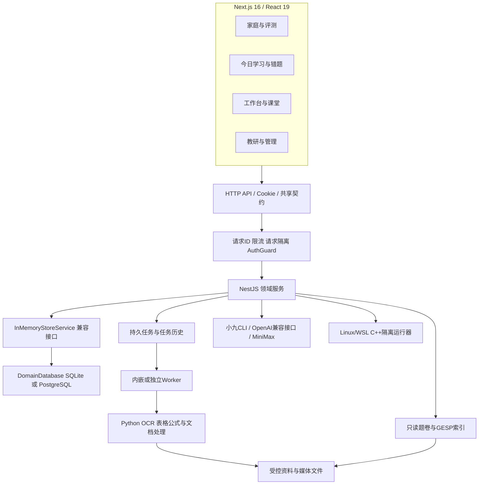

# StudyAgent 概要设计

基线、范围及逐项实现见 [设计总册](README.md)。本文描述当前实现，不把后续设想写成已交付能力。

## 1. 产品定位与组成

当前统一日常入口为`/learn`：按身份、档案和学科读取主要下一步，连接正式评测、计划、训练和课堂断点；原业务入口继续保留。实现见 [统一首页](details/06-learning.md)，完整增量目标见 [体验与内容总计划](../product/92-experience-and-content-master-plan.md)。

当前产品由四个相互协作的部分组成。

1. **小学三科测量与干预**：按当前年级、学期、教材和已学知识范围组题，保存独立作答事实，给出知识点估计和原因假设，经指导、训练与真实间隔复测验证效果。
2. **学习工作台与教学体验**：课程列表、五单元社会学课堂、逐项板书与逐句语音字幕、插问、四选一练习、项目、自由白板、PDF页级课堂、学案、日历与ICS。
3. **教研与资产工作台**：原始试卷检索、教材登记、章节与知识映射、内容导入、来源许可、五门禁量化素材审核、课程包、评分复核与运行看板。
4. **GESP独立编程试点**：官方与公开研究资料、1–8级候选知识图，1–4级自编试点的概念、跟踪、C++实现、辅助指导和保持任务。

不纳入当前内部使用阶段：付费、计费、课程Marketplace、机构租户体系、学校原生OAuth及双向成绩回写。应用内部教师复核授权仍保留，它与学校租户管理是不同能力。

## 2. 使用者与权限边界

- **家长**：注册账号、创建与受邀绑定孩子、确认范围、启用学生身份、授予教师复核权限、确认和调整计划、管理日程及家庭数据。
- **学生**：通过家长签发的学习码进入受限身份，访问绑定的学习活动，提交作答、提出进度候选、参与训练和复测。
- **教师/教研**：维护允许编辑的课程和量化素材；学生作答的复核还需具体学生授权。GESP研究资料限教研角色。
- **运营**：在被允许的研究、发布或运行视图工作；运营角色不等于监护人或可复核所有学生。
- **管理员**：受控创建、账号与角色维护、教研和运维入口。公开注册始终不能创建管理员。

权限由三个层次共同执行：会话有效性 → 角色与功能权限 → 具体学生、活动、题目、媒体或会话所有权。前端隐藏按钮只是体验措施，不能代替后端断言。

## 3. 工程与技术分层

工程分工：

- `apps/web`：页面、交互、作答控件、课堂播放器、浏览器导出、模型选择及会话客户端。
- `apps/api`：授权、业务校验、评分与测量、领域状态变更、内容与媒体接口、后台任务、持久化和worker。
- `packages/contracts`：共享类型、Zod输入Schema、17类作答协议、课堂/工作台/GESP等契约。
- `packages/config`：配置校验、默认模型与端口等非业务配置；配置值从环境注入。
- `packages/ui`：共享界面组件基础。
- `resources`：版本化教材登记、知识与题族资料、GESP研究与试点内容。
- `data`：运行库、媒体、导入缓存、原始资产和QA数据；含大量不应作为源码提交的状态。
- `scripts`：内容构建、资产迁移、文档处理、隔离运行、运维、备份与专项验证。

当前是模块化单体加可独立worker，不是微服务系统。不需要Redis或外部消息中间件才能跑通核心路径。

## 4. 后端模块边界

AppModule当前可达17个模块，包含AppModule与CoreModule；23个控制器接入运行。模块文件间存在复用依赖，不以目录数量计算独立服务。

- `auth`、`students`：账号、会话、家庭授权与学习身份。
- `content`、`question-workspace`：基础目录、题目三件套、导入与呈现。
- `diagnostics`：课程范围、蓝图、正式评测、评分、测量、原因及指导/复测。
- `learning`：今日训练、记忆、错题、工作台、课堂、日历。
- `library`：只读原始资产索引、整卷发布与测量素材候选。
- `reviews`：评测/训练量规复核与异常反馈。
- `student-media`：规范化图片/录音和回收。
- `processing`、`processing-files`：导入文件、持久任务与处理器。
- `ai`：模型目录、证据助教、结构化CLI、语音与文档模型。
- `privacy`：导出、删除及恢复约束。
- `gesp`：研究索引、编程试点和独立运行。
- `progress`：管理员历史只读与统计。
- `CoreModule`：数据库、请求隔离、事件、限流、运行指标、健康接口。

旧`assessments`、`missions`、`plans`模块源码保留，但没有被当前AppModule引入。旧写接口由RetiredLearningController统一返回410和新入口，不能将旧类方法计入当前功能完成度。

## 5. 三套容易混淆的知识与内容模型

### 5.1 基础目录与正式原子知识

`knowledgePoints`是早期基础内容标签；`knowledgeAtoms`是包含行为目标、达标标准、先修关系和版本的当前测量定义。当前正式诊断围绕后者运行。不能因基础题有标签就自动认为它具有可靠原子测量映射。

### 5.2 原始试卷、发布内容与可测量素材

原卷索引保留资料、缺失和媒体状态；`paperPublications`决定普通用户是否可见整卷；`measurementCandidates`经过来源、题面、媒体、评分、映射五门审核后，才建立正式`QuestionDocument/QuestionAnswerSchema/QuestionSourceRecord/MeasurementItem`。三个层次独立。

### 5.3 教学完成与知识掌握

`classroomSessions`表示当前账号读到哪里、课堂题怎样回答；`studioStudyPlans`和`studioScheduleEvents`表示学习安排是否执行；`diagnosticResponses`及其有效评分才进入正式量化计算。课堂题、重复原题、闪卡阅读和计划完成不能自动写成掌握提升。

`courseProjects`独立保存冻结的项目定义、各阶段草稿、自评准备、提交快照、人工复核和AI建议。项目修订不覆盖已提交作品，量规自评不转换为正式掌握度。课程和课堂入口共享同一单元项目，旧课堂草稿可主动引用。教师读取和复核依赖当前有效授权，不能凭项目地址绕过。

## 6. 三类计划

- **DiagnosticGuidancePlan**：来自正式报告，冻结证据、教学、来源和成功标准，家长确认，进入训练与正式复测。
- **StudioStudyPlan**：工作台排程，将学习/练习/迁移/回顾安排到日历，支持任务状态，不自行计量能力。
- **GespGuidancePlan**：独立编程轨道，以概念、跟踪、实现和保持证据生成，家长确认，使用独立版本和复测包。

旧`StudyPlan`周计划只用于历史兼容，不是以上任一种的替代。

## 7. 关键设计决策

1. **事实先于解释**：响应、提示、曝光、评分修订、题目和定义版本都可追溯；原因是带支持与反证的状态对象。
2. **冻结而不是倒改历史**：活动保存开始时的定义、题目、标准答案、量规和教学版本；新内容不覆盖旧报告。
3. **先预览再确认**：正式蓝图、课程、学案、工作台计划、导入和数据删除用预览/影响指纹减少误操作。
4. **规则与AI分工**：选题资格、判分、掌握估计、权限和发布门禁由规则执行；模型补解释、活动文字、板书或文档结构。
5. **领域事务与独立大索引**：频繁改变的学生业务进入领域文档库；大规模原始题卷与GESP检索使用独立只读SQLite索引。
6. **可重试的后台处理**：文件识别与长处理进入持久队列，业务变更和任务请求同事务提交，以租约栅栏避免旧worker提交结果。
7. **可观察的不足**：缺题、未测、来源未核实、模型失败、未到复测时间均保留明确状态；不以AI叙述补齐未知。

## 8. 对外依赖与降级

普通范围确认、确定性组题/评分、规则估计和持久化不依赖大模型在线。聊天和课堂插问依赖小九CLI；部分兼容分析仍依赖OpenAI兼容配置；语音优先MiniMax；PDF处理依赖Python与可选模型；录音需FFmpeg；C++需Linux或WSL工具链。各能力分别报告可用性，不把“系统可登录”当成所有外部能力可用。

## 9. 当前验收与非功能边界

应用具备SQLite/PG持久恢复、请求隔离、限流、角色授权、规范化媒体、后台任务与三组CI。当前最新业务代码基线的本地验收为746项通过、6项按原配置跳过，14项浏览器通过；此设计整理主要运行源码引用、接口覆盖与文档检查，不重新执行全部运行测试。

这不替代真实学生/教师效度、教材逐课时人工审核、全部设备与辅助技术、全量GESP内容审核、完整HyperKnow动态体验或精确像素资产验证。详见 [完成边界](06-boundaries-and-follow-ups.md)。
