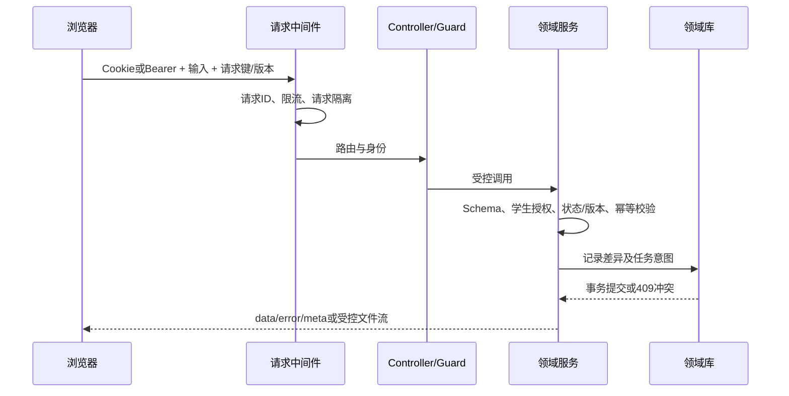

# 核心业务详细设计

本文补充 [105项功能实现目录](01-functional-framework.md) 中跨模块的处理顺序、算法和失败行为。各接口完整参数签名与实现行号见 [接口索引](generated/api-reference.md)。

## 1. 通用请求与事务

统一首页`GET /learning/home`是只读聚合：明确选择档案时先检查授权，不能以列表第一项替代无效选择；读取当前范围、今日安排和证据记忆，优先提供未完成评测、到期复测、监护决定、训练和课堂断点。链接指向已有对象，打开首页不创建活动。浏览器以显式URL优先、按主体隔离的标签页选择其次，校验缓存结构；切换时清空旧数据并取消请求，过期响应不能覆盖新档案。完整行为见 [E01交付](../product/experience/implementation-log.md)。

Controller负责HTTP适配和部分角色门禁，具体学生权限、业务状态、输入Schema及版本检查分布在领域服务。`ApiResponseInterceptor`在成功处理后调用`commitRequest`，提交成功后才形成普通JSON响应。文件流保持`StreamableFile`，不套业务JSON。

`requestKey`是业务级幂等键，不是全局万能防重。各服务按主体、业务类型、对象或会话保存请求摘要；同键同输入返回既有结果，同键不同输入应冲突。某些老兼容操作仅有状态约束，不能声称所有写接口已经统一相同幂等协议。

## 2. 范围确认与定义兼容

输入包含`studentId + subject + grade + term + textbookVersion + progressMode + learnedAtomIds/selectedLessonIds + minutesPerSession`。家长确认产生独立版本；学生通过提议流程提交候选。

教材模式先读取版本化登记和章节，再使用已批准`TextbookAtomMapping`得到知识范围，并保存教材修订、所选课时和映射快照。尚未映射课时写入缺口，不能依赖同年级或关键词猜测已学内容。

知识定义指纹覆盖测量语义。测量映射和题面具有各自内容指纹；新评测只接纳仍与当前定义/内容匹配的已审核映射。旧会话使用冻结版本，旧报告可以展示，但与当前定义不可比的证据不直接汇入新画像或新指导计划。

相关实现：[CurriculumService](../../apps/api/src/modules/diagnostics/curriculum.service.ts)、[measurement-definition.ts](../../apps/api/src/modules/diagnostics/measurement-definition.ts)、[TextbookRegistryService](../../apps/api/src/modules/diagnostics/textbook-registry.service.ts)。

## 3. 蓝图与选题算法

### 3.1 资格过滤

候选题需要同时满足当前范围、知识和题目版本、映射审核、发布与来源资格、可用作答协议、当前媒体能力等条件。需要追溯先修时，在蓝图中明确标为基础核查，不将未确认的新教学目标偷偷混入。

### 3.2 六类策略

- 起点评测`baseline`：默认12题，上限30，最多20分钟。
- 单元`unit`：默认8题，上限20，最多15分钟。
- 阶段`phase`：默认20题，上限30，最多25分钟。
- 微测`micro`：默认4题，上限6，最多3分钟。
- 原因核查`verification`：默认6题，上限12，最多10分钟。
- 间隔复测`retest`：默认4题，上限8，最多10分钟。

最终预算还受本次请求和已确认时长限制。预计秒数来自素材标注，是学习负担预算，不是速度常模。一、二年级每组2题，其他年级每组3题。

### 3.3 选择顺序

在各目标知识点间轮询，排除已选相同题目及本点重复规范题族，并核对累计预计时间。排序优先未见过题、适用的基础锚点、未覆盖维度、策略维度顺序、难度和种子哈希排名。随机种子使同一冻结输入可重放。

原因核查使用单独验证组选择器，先确保各观察组所需的知识点、维度和独立题族。停止原因可能是验证组已满足、题量预算、时间预算或独立题族不足。覆盖不足在蓝图和报告中保留。

### 3.4 预览与确认

`diagnosticBlueprints`保存30分钟。开始前重新计算范围、题面、定义、曝光与指纹；任何影响题组的变化需要重新预览。成功开始保存题目/映射/答案/量规/知识快照和请求回执，不从当前题库动态替换进行中题目。

实现：[assessment-blueprint.ts](../../apps/api/src/modules/diagnostics/assessment-blueprint.ts)、[verification-blueprint.ts](../../apps/api/src/modules/diagnostics/verification-blueprint.ts)、[DiagnosticsService](../../apps/api/src/modules/diagnostics/diagnostics.service.ts)。

## 4. 冻结范围内的自适应路由

自适应改变本组已有题目的顺序，不改变本组已确认题量和范围。

1. 开始选择目标知识点的基础理解或操作锚点。
2. 上一题待复核、提示后回答、曝光、跳过或不会时，不按独立对错分支，补充同点基础对照。
3. 基础独立失败时，优先冻结集合里最近的尚未核查先修点；没有合适先修则做同点不同题族对照。
4. 迁移独立失败时返回同点基础，观察是否是表示转换差异。
5. 基础独立成功时尝试迁移；先修核查成功后返回原目标，仍不直接宣布原因解决。
6. 无专门分支可用时，选择本组观察较少的目标并记录覆盖理由。

每步保存`rule/reason/basis/focusAtomId`。复测采用固定题组，避免把动态路径差异混成可比保持结果。

实现：[adaptive-routing.ts](../../apps/api/src/modules/diagnostics/adaptive-routing.ts)。

## 5. 作答、提示与评分

### 5.1 统一答案信封

现代响应采用`{ questionId, mode, response }`。草稿和最终响应使用同一协议族，草稿允许部分完成；最终提交要求合法完整结构。旧标量输入有兼容处理，但不能跳过现代题目配置校验。

当前17种模式：

- `single_choice`、`multiple_choice`、`boolean`：单选、多选、判断。
- `text_blank`、`numeric_blank`、`formula_blank`、`multi_blank`：文本、数值、公式、多空。
- `table_fill`、`matching`、`sorting`、`drag_drop`、`hotspot`：表格、配对、排序、分组拖放、热点。
- `geometry_draw`、`stepwise`、`image_upload`、`short_answer`、`audio_record`：绘图、分步、图片、短答、录音。

公开配置只包含互动数据，私有评分键不返回控件。禁止危险键名、超长载荷和无界笔迹；绘图坐标规范到0–1。具体字段见 [answer-protocol.ts](../../packages/contracts/src/answer-protocol.ts)。

### 5.2 响应事实

`answered`、`skip`、`dont_know`分别表示作答、跳过和自报不会。保存首次响应、耗时、提示等级、曝光、题目/映射版本和提交时间。重复提交不产生新独立样本。暂停保存草稿；提前结束只评估已答证据。

### 5.3 判分与复核

`gradeResponse`先检查协议，再做受限文本归一、数值/分数解析、容差、单位、集合及各模式的确定性比较；公式仅使用受限算术解析，不执行输入代码。多空、表格和结构题可产生逐项`scoreDetails`。

空白输入不能转成0。步骤、短答、绘图、图片和录音进入`pending_review`；标准答案与冻结协议不一致也进入内容复核。授权教师按冻结量规追加`ScoringRevision`，原始答案与原报告保留。

实现：[scoring.ts](../../apps/api/src/modules/diagnostics/scoring.ts)、[scoring-review.ts](../../apps/api/src/modules/diagnostics/scoring-review.ts)、[ReviewsService](../../apps/api/src/modules/reviews/reviews.service.ts)。

## 6. 掌握估计的实际公式

算法版本为`rule-estimate-v2`，是规则化概率估计，并未经过学生人群常模标定。

### 6.1 证据权重

只有已评分、有效审核映射、未提前曝光的响应参与。按提交时间去重同一学生/知识点/题目/题目版本；题族通过规范化身份判断独立性。

`w = mappingWeight × hintWeight × familyWeight × 2^(-ageDays / 60)`

- 无提示、一级、二级、三级及以上提示的`hintWeight`分别是`1、0.6、0.3、0`。
- 某独立题族第一条权重系数1，其后为0.5。
- 使用60天半衰期衰减，而不是把旧表现视为永久有效。

### 6.2 后验与区间

令`n = Σw`，`s = Σ(w × score)`：

`a = 1 + s`，`b = 1 + n - s`，估计均值为`100 × a/(a+b)`。

Beta分布的2.5%与97.5%分位构成模型下95%可信区间。实现使用Lanczos log-gamma、连续分式与二分分位求解；这是实际分位计算，不是固定误差条，也不是已验证的人群能力置信保证。

无证据显示`null/unknown`。四条权重均为1的全对证据得到均值约83.3%，并不等于“能力83.3分”或“稳定掌握”。这是计算示例，不是实际学生数据。

### 6.3 状态规则

- `unknown`：有效样本量为0。
- `insufficient`：有效样本小于3，或无提示独立题族少于2。
- `secure`：前述条件满足，并且有效样本至少6、区间下界至少70、迁移与保持均验证。
- 其余均值至少70为`fragile`，否则为`learning`。

迁移验证需要至少两个无提示正确独立题族；保持验证需要至少两个真实间隔至少一天、无提示正确的保持题族。各维度单独输出估计和有效样本。原始正确率、有效样本量和掌握估计是不同指标。

实现：[measurement.ts](../../apps/api/src/modules/diagnostics/measurement.ts)、[family-identity.ts](../../apps/api/src/modules/diagnostics/family-identity.ts)。

## 7. 原子观察、原因假设与验证

### 7.1 原子步骤观察

组合题只有经审核的`ComponentBinding`才能把评分分项关联到子点。`scoreKeys`指定观察字段，`requiresKeys`表明上游条件。系统区分“本步未达标”和“上游阻断，尚不能判断本步”。分项观察用于路由核查，不作为额外独立响应再次计量。

### 7.2 原因规则

- `procedure_gap`：基础理解/操作至少两个独立题族未达标支持继续核查；至少两个达标构成反证。
- `prerequisite_gap`：目标至少两个题族未达标，且某直接先修至少两个题族未达标才支持；每个直接先修各至少两个达标构成反证。
- `representation_gap`：基础至少两个题族达标、迁移至少两个题族未达标，且两组至少四个不同题族才形成支持；迁移独立达标提供反证。
- `retention_gap`：基础成功与真实间隔后的保持失败共同核查；当天反复刷题不能证明保持。

支持和反证同时成立时保持`inconclusive`。当前规则置信级别不提升为高置信医学或智力诊断。每个假设保存观察、解释、替代解释、支持/反证ID、所需探针、规则版本、定义指纹和状态历史。

### 7.3 关闭与重开

同规则版本下，失败后的多个独立成功可使原问题`resolved`；关闭后新失败可`reopened`。规则或题族身份变化需要重新分析，结论变化会注明规则变化，不能自动视为学生进步。

实现：[component-observations.ts](../../apps/api/src/modules/diagnostics/component-observations.ts)、[diagnosis.ts](../../apps/api/src/modules/diagnostics/diagnosis.ts)。

## 8. 指导、练习与复测闭环

正式计划必须来自已完成且定义仍可比的评测。规则优先支持的先修阻断和非稳定点，按每天预算最多选择3个行动，分配时长，冻结证据、批准教学和可核对来源。

AI可补充计划摘要和活动描述；行动ID、知识点、证据、成功标准与资源由服务约束。家长确认后进入今日任务。练习采用新题和冻结行动，提示、复做与主观评分单独保存。

复测按1、3、7、14日安排，支持到期启动与改期。复盘比较可比的知识定义、独立性、迁移和保持；无足够证据则写“待验证”。家长的复盘确认是阅读/决定记录，不是能力测量。

相关实现：[GuidanceService](../../apps/api/src/modules/diagnostics/guidance.service.ts)、[LearningService](../../apps/api/src/modules/learning/learning.service.ts)、[NotebookService](../../apps/api/src/modules/learning/notebook.service.ts)。

## 9. 内容发布与测量资格

整卷发布和单题测量发布相互独立。原卷的缺题槽位、媒体缺失和PDF-only状态不抹平；自动OCR、AI结构化和教材映射候选均需人工审核。发布检查既看审核结论，也看审核所绑定的内容/定义指纹，防止“改内容、沿用旧审核”。

## 10. 工作台与课堂播放器

### 10.1 课程和导航

`/studio`使用`view/student/subject/course`维护当前页面和学习档案；单元与面板保留在查询参数。加载代次丢弃过期响应，切换档案/学科清理旧活动状态。成人课程与学生课程共享导航，课堂学习结束返回原学生、学科、课程、单元和面板。

课程库以`courseQuery/courseState/courseType/courseSource/courseRecent/courseSort`保存组合条件，允许值与长度受控；搜索替换历史条目，条件选择增加条目。当前课时集合与真实记录区分未开始、进行中、讲解已读，不使用课程创建时间冒充学习时间。类型/来源/近7或30天与排序共同作用，空结果可清空。进入成人/小学目录及课堂返回保留条件；GESP按身份提供独立轨道入口。显式无权限档案返回403，不退回另一个孩子。见[课程库交付](../product/94-course-library-continuity.md)。

蓝图先编辑名称/目标、范围内1～30点和5～60分钟预算，再预览来源、资格缺口及全部单元活动。返回修改使旧预览失效；预览取消中止请求且不建课。创建复用完整范围校验并比较指纹，按主体/命令摘要/请求键绑定课程回执；回执丢失后重试恢复原课，范围后来改变不重做原确认。可选`pace`按参考时长分段，各时段不超过预算并链接实际活动；语言沿用已审核素材。具体规则与旧回执边界见[蓝图交付](../product/95-course-blueprint-editor.md)。

### 10.2 播放与中断

课件由`ClassroomStep`组成，讲稿与板书blocks分离。`cursor`指当前步骤，`revealed`指已揭示步骤，`sentenceCursor`指当前句。每句单独请求音频，结束后推进；只预取下一句。静音使用阅读节奏；暂停停止自动推进；刷新恢复持久断点，当前句从头继续。

新会话冻结`speech-v2`表现快照：每个节点和新插问均保存单元正文、原讲稿UTF-16范围、源SHA-256及稳定ID。中英文断句保护小数/版本、常见缩写、域名、URL、邮箱、代码与公式；长句按停顿或词边界拆分。服务端读取验证快照完整性，不重新切分来修补断点；字幕、语音、表格逐行和配图可见上下文读取同一单元。位置写入与语音请求核对版本/单元ID，拒绝旧索引误配；音轨缓存含会话、节点、版本、单元和音色。

无新字段的旧课堂投影确切`legacy-v1`规则，读取不迁移。设置显式更新时，按旧句原文起点映射到新句，完整保留旧表现快照和原始答案/提示/阅读事实；原修订号、请求键和命令摘要保护冲突与回执重放。成功后暂停，旧音轨与预取通过中止信号及操作身份失效。关闭确认不发请求；已经发出的操作可能先在服务端提交，关闭只停止等待，重新打开可读取实际保存状态。取消不冒充事务回滚。

静音时`speech-v2`按汉字与英文词数估计等待，不逐字计英文；仅作为文字呈现节奏。HTTP断开传递到MiniMax/OpenAI请求，取消后不重试；超过4096字的单段语音明确拒绝而不截断。真实双语音轨解码、合成音轨驱动的浏览器时序、真人听感与实机分别记录。见[字幕规格](../product/102-classroom-sentence-timeline.md)。

板书要点、图片和表格按项出现。对话历史保存讲稿与插问，板书不主要采用逐字打字。插问暂停课程，返回受控要点或三标签关系图。练习助教看到当前题面而看不到私有答案键，调用后保存辅助标记。

### 10.3 两种代码运行

课堂的JavaScript示例在独立runner与Worker中运行，CSP限制网络，超时停止，不作为服务端代码执行。GESP C++则在Linux/WSL隔离工具链执行，两者语言、权限和证据完全不同。

### 10.4 导出

课堂导出已读板书和插问Markdown，打印可保存PDF。自由白板通过Canvas与MediaRecorder导出WebM，可叠加逐幕语音并导出SRT。音频上下文和媒体轨道在结束时释放。导出需要浏览器能力，且不自动生成新的能力证据。

### 10.5 练习、单元新情境与版本恢复

微课包含185道课堂题，五单元另有60道新情境题，逐一对应60个主题。组装时校验主题覆盖、选项与答案，并稳定打乱选项；单元版本摘要含私有评分定义。题目主题和目的公开，答案与解释冻结于服务端会话，提交后才返回解释。

首课5题，其余59课各3题；30表格题与2图示题分布五单元。两级提示冻结在私有`hintKeys`，公开仅返回级数和已读`hintReceipts`；指定level顺序读取，重放或新键重读同级均不升级。`disposition`区分answered/skip/dont_know，旧空答案仍按skip处理；首次回执冻结提示级别，不会不计为答错或跳过。独立练习失败可见，重试清除旧连接错误。

当前练习版本包含私有答案/提示摘要；另以讲解目标、步骤和验证入口的严格内容身份计算`readingProgress`。练习更新时可保留完全相同讲解的旧已读事实，不能将旧单题结果复制为新三题组表现。旧会话缺少提示表时仅使用其冻结原提示。完整实现及证据见[Practice交付](../product/96-classroom-practice-and-progressive-help.md)。

`POST /learning/classroom/sessions/:id/hints`先保存提示事件再显示帮助，校验会话/题目权限和请求重放。作答合并服务端辅助事实，客户端不能用false清除；首次答案锁定。共享`classroomPracticeSummary`仅计算冻结题组首次回执，区分独立正确、答错、跳过、不会、辅助与未答。重开到首个未答题，全部完成则显示复盘；可回看解释和返回对应微课，不推断稳定掌握。

会话地址包含具体`session`，GET恢复原快照并校验lesson/course一致性。仅有旧版本时普通入口恢复旧记录，明确提交`useCurrentVersion:true`才开新版；目录提供当前账号旧记录。旧题按冻结量规评分，新题不能混入旧卷。详见[本批交付](../product/93-classroom-unit-checks-and-review.md)。

## 11. PDF与模型结构复核

上传PDF先存受控原件并进入持久任务。Python输出原页图、文字层/OCR文字、bbox、置信度和段落/表格/公式候选。需要模型复核的页最多选8页送小九CLI；结果按页合并，不覆盖原始页图。

表格使用可选择的HTML单元格，公式由LaTeX候选通过KaTeX显示。用户必须对照原页确认；内容变化时旧`expectedUpdatedAt`不能确认新结构。模型失败仍可展示本地候选并重试。页码匹配可能只是关键词候选，不能宣称人工批准引用。

## 12. 日历与ICS

月视图生成实际4–6周网格，周视图7天；本地日期用于选中日和时间呈现，持久事件使用ISO时间；全天事件按结束日排他处理。URL保存`date/mode/tasks`，刷新恢复。

手动事件用`revision`控制编辑，支持已确认/待处理、完成/重开、内容和时间修改。批删在任何删除前校验全部ID、学生权限和手动事件资格；切换日期、视图或筛选清空批选。

计划事件必须通过计划的`expectedRevision`更新，订阅事件只读。ICS连接校验公网HTTPS、重定向与体积并加密订阅地址，按来源与UID刷新。当前是手动刷新与文件互通，没有学校原生OAuth或双向成绩回写。

## 13. AI调用分工与失败处理

- 模型目录合并小九本机配置与兼容列表，Auto解析为默认`deepseek-v4-flash`，界面标为DeepSeek V4.1 Flash。
- 普通聊天与课堂插问通过小九CLI的临时只读调用，输出JSON Schema；服务层验证引用与板书。网页当前不是逐token流式返回。
- 指导/分析保留部分OpenAI兼容实现；有些路径有规则降级，有些能力缺配置直接不可用。不能统一宣称全部AI都已经由一个渠道承担。
- 语音优先MiniMax，解析流式PCM后返回完整WAV；只有未配置MiniMax时才选择已配置OpenAI语音。失败不静默切换另一付费供应商。
- 开发期两张课程位图保留；运行期配图通过集成aigw-imagegen生成当前教学节点的参考候选。用途、补充要求、原始提示词、模型与实际文件独立保存；只有显式选用才加入原节点板书。失败、取消、撤权、并发和过期租约均检查，候选不升级为正式教材或测量依据。

AI可以解释和提议，不能直接替学生答题、改变确定性评分、写入稳定掌握状态或跳过教研发布门禁。

## 14. 项目阶段、量规与修订

显式开始项目后冻结目标、阶段字段、四级量规和指纹。草稿保存允许不完整字段和证据，自评准备一起保存；提交检查阶段字段、证据及全部维度依据，冻结作品并指向前一提交。后续编辑不修改旧快照，再次提交要求修订说明。重复命令先按请求键与摘要重放；新的命令再检查修订号，冲突不覆盖已保存稿。

学生只写自己的项目，绑定家长或当前授权教师可查看孩子产物并复核指定提交；成人不能登记自己的作品为人工审核。AI只返回已保存稿的建议，取消不追加，修改后保留其针对旧稿的身份。旧课堂草稿主动复制成参考，原件不清空；所有项目结果不进入诊断掌握度。详见[项目规格与交付](../product/97-versioned-course-projects.md)。

## 15. 来源资料生成与可恢复课堂

`SourceCourseService`把文本段落或PDF实际页码转成有版本/哈希的正文快照；私人资料无studentId，孩子资料每次检查具体授权。正文最多10页/段、12000字符，实际序列化上下文最多18000字符，超限拒绝并提示缩小选择，不截断来源。可选知识目标只作参考，不赋予测量资格。

`SourceCourseWorkerService`认领`learning.source-course.generate`，复用小九CLI临时只读结构调用，显式传递schema及字段/长度错误用于一次内部重试。验证1～6课完整结构、来源短引用、选项互异与正确位置变化；最终写入同时校验账号、授权、状态、任务租约。取消、撤权、删除或旧租约都不能发布内容。数值自检是模型指令，不是通用数学证明或教师审核。

候选可改课程/课时标题、目标及删除课时；revision与fingerprint保护预览，确认按请求键重放，当前来源改变时拒绝旧确认。课堂冻结私有答案/提示、六段讲解与引用，保存首次表现和断点；中文/英文方向词跟随讲解语言。来源正文与PDF原页可对照，正文快照不会被后续OCR更新改写。归档阻止新课堂，旧会话可继续读取自己的快照。共享孩子已确认课程在创建者关闭账号后保留，管理权不自动转给其他账号。

生成题不加入正式诊断题库；结构/引用通过仍可能含学科错误。真实默认模型的小样本、此前发现的错误及其修正、浏览器替身和剩余范围分别记录，见[规格与交付](../product/98-source-backed-course-generation.md)。

### 15.1 完整稿修订与答案接触

成人创建者显式POST打开候选教学稿，记录首次答案接触，返回当前/初始生成稿的独立副本；孩子和其他账号不能读取。PATCH content整份通过共享Schema、真实引文和选项规则后保存，绑定修订号/请求键并更新内容指纹，原始生成稿保持不变。直接修订也记录答案接触。确认绑定最新指纹；已确认和来源变化后拒绝原地修订。

新课堂冻结创建者的authorship接触标记，服务端写入首次回执并排除独立成功；学生正常学习不继承作者标记。界面按课/环节编辑和对照来源，冲突/断网保留完整本地稿，读取公开状态不覆盖保存基线，离开可导出后再继续。512KB的有界JSON解析及错误脱敏由主API与QA共用。详见[完整编辑交付](../product/99-source-course-content-editor.md)。

### 15.2 分课流水线、复核与原子检查点

新任务在创建时冻结输入，旧队列在领取时记录捕获方式；缺原始输入的旧候选明确为未知。首次解析Auto后固定实际模型。先生成路线并给每个来源分配课时或列为未覆盖，再逐课编写、逐课独立调用模型复核。保存路线与初稿时间、内容摘要和复核记录；普通进度只返回阶段、数量和不含答案的问题概况。

复核问题必须能在对应字段或题目找到摘录；pass不带问题或修改，uncertain保留具体疑问，revised仅返回改变的字段或单题。服务端应用修改后再次核对整课、真实引用及选项，并拒绝没有实际修改的“修订”。首次稿、AI修订稿与人工稿分开；人工修改后的界面标明旧复核针对修改前内容，教师审核仍为pending。

每个阶段通过checkpoint TaskFence与领域内容在同一SQLite/PG事务提交，保留running租约；心跳只续租，不把较旧进度写回。恢复时核对流水线、输入/来源、内容摘要、实际模型和已存复核，复用合法阶段。完成整门候选才用completion栅栏结束任务。取消、撤权、过期worker或领域冲突拒绝阶段写入，课程与进度一起回滚。详见[分课生成规格](../product/100-source-course-generation-pipeline.md)。

## 长资料课程编译第一增量

[规格103](../product/103-long-source-course-compilation.md)与STUDIO-23补充原小课程路径：原文按页/段冻结，预检计算无损块范围及预算；长模式进入v3编译器，块索引、分组规划、写稿、复核独立持久化。规划用S编号减少模型拷贝稳定哈希时的错误，保存时恢复稳定块身份并验证无遗漏。课时写稿和复核只读取分配的原文，单次上下文18000字符；120页/180000字符/180块/24课是本次运行预算。

进度使用轻量投影，原文按页/块加载，长课私有审稿按稳定课时加载。删课重排不改变课时身份；最初规划与当前引用分别计算，人工修订不改原始稿。原稿与复核的输入/输出摘要、主体和固定模型在加载时再次核对。TXT/PDF原件及新处理页图纳入哈希备份；阶段payload进入受控恢复，家庭携带JSON只输出其元数据。

PDF两条提取路径移除静默文字/行数截断，模型段落是候选结构，原文继续保留。后续[规格104](../product/104-long-pdf-processing-and-source-lifecycle.md)与[交付106](../product/106-original-repair-product-delivery.md)已接入50MiB/120页分块上传、逐页续跑、原件文件核对与可恢复修复；真实120页PDF及两工作台通过独立验收。复杂扫描/跨页表格/公式与真实教学材料审核仍继续。

## 插问结构化笔记与按句呈现

[规格109](../product/109-classroom-comparison-formulas-and-reply-pacing.md)将持续插问的短要点、2～4列表格、最多3个公式与实际口语分开。模型只能给reply里的唯一原词句锚点；严格协议校验数量、顺序、单元范围和受限LaTeX，服务端冻结speech-v2后生成unitId与SHA，再同消息事务发布。旧聊天路径和旧记录保持原协议，不推测历史时序。

ReplyBoard按保存单元整体呈现要点/表格行/公式。朗读等音轨结束，文字阅读按估计节奏；开始定位对应白板页，学生可展开完整笔记，停止回原课字幕而不自动续播。Abort同时结束请求、Audio和计时等待；旧回调不清新操作状态。完整图表进入Markdown、打印和无外部资源的MathML HTML，原字符串不能当HTML执行。读取、提示和运行仍不成为正式能力测量。

## 资料课程版本与影响事务

[规格110](../product/110-source-course-revisions-and-lifecycle.md)在sourceCourses保存可选家族、父版本、单调版本号与动作事件；旧课默认为独立第一版。创建者复制已核对的短/长课与原始阶段证据形成ready修订，taskId为null，不重用原任务或冒充新模型调用。新阶段记录绑定新课程身份，复制来历单独保存。

四路API提供版本、修订、只读影响预览与变更确认。预览指纹按家族状态/内容生成，确认重新授权与核对；发布/恢复把被替代正式版归档并激活目标，同一事务防止半完成和双当前版。重放在新状态检查前返回原结果；版本/内容/并发变化需重新预览。普通归档、撤回原因和私稿放弃各有明确状态。旧课堂、代码、原句与首次作答保持原快照，个人lastSessionId提供准确恢复入口。

普通读取和家庭导出隐藏其他创建者的未发布/放弃稿、私有版本ID与阶段关系；账号关闭删除这些候选与原稿阶段，保留共享孩子已发布内容。学生版本历史是单独允许的只读路由，没有管理权限。浏览器在账号/课程隔离的sessionStorage保存未确认命令，掉回执/停止等待后使用相同命令找回；网络中止不会被说成服务端已撤回。

## 项目原件、附件快照与恢复

项目文件使用独立的projectAssetUploads/projectAssets领域集合；传块和处理不改courseProjects.revision，文字仍可保存。创建绑定项目、阶段、冻结定义指纹与完整定义摘要，并保存最初的监护binding、学习授权版本或教师assignment。当前读写权限每次重查；发布前同时核对原授权，重新授权不能让旧worker恢复资格。实现见[访问边界](../../apps/api/src/modules/learning/course-project-access.ts)与[文件服务](../../apps/api/src/modules/learning/project-file.service.ts)。

上传ID单调独立，原件目标assetId由同一个UUID确定，完整接收先核对各块/大小/SHA，再独占发布完整inode；数据库提交失败后可找回同一目标。完整文件与持久处理任务同事务登记。规范化工作在精确task/token目录，处理结果在领域与任务fence同事务发布；取消回执准确区分cancel_requested与已结束，旧响应和失去租约的worker不能发布。见[存储](../../apps/api/src/modules/learning/project-file-storage.ts)、[处理](../../apps/api/src/modules/learning/project-file-processing.ts)和[worker](../../apps/api/src/modules/learning/project-file-worker.service.ts)。

PNG/JPEG解码、旋转和去元数据；PDF用本地PyMuPDF生成静态页，拒绝加密、超页数、异常几何或超预览字节预算；文字/代码验证完整UTF-8且不执行；录音用既有ffprobe/ffmpeg解码成规范WAV；Office检查有界ZIP、CRC、容器主类型/命名空间并拒绝宏，当前只提供下载，不承诺内容预览。原件SHA与显示件/静态页SHA分别保留；文件名只用于显示，不拼磁盘路径。

草稿的attachments仅保留资源引用与说明。保存/提交时在文件租约内核对实际原件和显示件；提交另冻attachmentManifest，包含该版本原件/显示件摘要、类型、大小、文件名、处理版本与说明。量规文件依据只能引用同一作品/同一提交的文件；替换草稿引用不能改历史原件。旧无附件字段保持缺省，旧AI稿本身份和重放语义不补造新字段。

文件流一直持有读租约至真实结束/断连；已经断开的请求在返回流前也会释放，家庭TAR流同样绑定响应关闭。删除先提交领域状态和内部回收任务，collector取得purge fence、排除活读者/写者再逐一移除已知文件；活跃、未知或变化中的文件保留并持久延后，不消耗失败次数。失活上传24小时后收尾，已被提交引用的原件不能普通删除。

完整性检查是只读SHA核对，不写学习事实。家庭归档包含当前允许项目的真实原件/显示/预览与清单，剔除授权、任务和暂存内部字段；账号关闭保留共享孩子合法提交，并匿名原监护归属。SQLite及PG原生备份提取新集合实际引用；恢复核对每份文件，并应用较新删除账本，不能因旧备份复活已删项目字节。

AI建议只接收已保存文字、证据和文件说明；原始字节不自动送模型。完整序列化上下文超过18000字符时拒绝，并让使用者明确选择字段/证据/说明范围，完整作品保持不变。建议保存所选范围及全稿身份，不伪称看过附件；项目反馈、自评和人工复核继续不写独立掌握度。完整多模态研读、Office内容渲染、真实设备与教师验收另按主计划推进。
## 可恢复作答与首次提交（112）

诊断继续使用diagnosticDrafts，训练继续使用practiceSessions.drafts；两者共用[草稿协议](../../packages/contracts/src/answer-draft.ts)和[事务内校验](../../apps/api/src/common/answer-draft.ts)。公开题面保留旧draft形状，另返回draftState，包含当前账号、题面摘要、草稿修订、已提交次数、保存时间与编辑资格。摘要仅使用冻结公开题面/输入配置及活动身份，不包含评分键。

v2保存绑定actorId、baseHash、attempt、expectedRevision和稳定requestKey。旧无修订草稿按0读，旧写也推进修订；进入v2后拒绝无栅栏覆盖。回执日志按账号与请求键识别，语义摘要对JSON对象键排序，数组顺序保留；同键异参拒绝。旧回执分别返回acknowledgedRevision与currentRevision，不能据此把较新本地输入标成已保存。每题1024条回执为明确上限，不静默丢弃旧回执。

[浏览器控制器](../../apps/web/lib/answer-draft.ts)按账号/活动/题目保存标签页副本，范围对象隔离缓存、计时器、请求和迟到响应。未确认保存串行结清，期间的新输入继续保留；网络恢复重放原命令。冲突展示本地与刚读取的服务端表达及时间，明确选择前下载完整副本。存储不可用时保留内存稿并提供下载；切题/退出前结清，无法保存时由学习者选择保留副本再离开。

提交先结清当前保存队列，再冻结答案、耗时、请求键与草稿栅栏；丢回执或刷新先按原命令核对真实提交。诊断首答不改变；训练再想一次明确进入新次数，题目URL和本地订正稿共同恢复，旧首答、提示和参考曝光不被覆盖。v2提交后保留草稿修订日志作为栅栏，不将旧请求当新首答。公开反馈/家庭导出剔除内部摘要和命令日志。

文字填空、选项、公式、结构表达、绘图和StudentMedia共用真实诊断/训练页面；控件按活动/题目/冻结版本重挂载，公式与绘图在提交期间锁定。媒体操作对有稳定上传身份的409冲突有限重试，每次重新鉴权，耗尽后保留续传；上传成功仍不产生评分或掌握结论。双库重开、SQLite空根恢复、PG原生恢复及最新删除账本有独立测试，完整浏览器、设备与教师门禁见[112收据](../evidence/2026-10-25/answer-draft-acceptance.json)。

## 普通助教持久任务、历史与取消

[规格113](../product/113-durable-assistant-conversations-and-history.md)将普通助教接入assistantTurns与已有SQL任务队列，保留assistantSessions/assistantMessages。旧AiService.chat和HTTP同步入口通过同一端口委托新任务，不能另写一套消息或帮助事实。prepare冻结安全上下文与内部题目/授权指纹，render在事务外调用模型，publish在租约事务内复核原授权、正式首答/订正代次和当前依据后，同时保存消息对、insight、帮助及任务终态。

公开contextVersion只摘要安全投影；包含评分键的内部bindingHash、prepared和授权来源不公开。未提交草稿编辑不使任务失效，正式首答或订正变化则拒绝迟到发布，避免补造提交前帮助。诊断进行中固定规则；显式模型不可用、引用越界或答案泄露明确失败。相同原命令在重放时先认回执，不重新解析Auto、不重复计每日额度；取消和失败也占原命令额度。每账号一个活跃普通任务通过SQL事务和唯一队列键实现。

浏览器[会话控制器](../../apps/web/lib/assistant-conversation.tsx)按账号和完整学习位置保存原文、待确认命令和任务身份。掉回执后先GET精确requestKey，不自动新建问题。内存保留存储失败时的输入，并可下载完整副本。epoch丢弃换号、换题和历史切换后的迟到结果；回看旧任务时仍跟踪后台活跃任务。状态按真实任务版本轮询，每次鉴权；已校验正文一次显示，不制造逐字动画。

停止等待只中断本机请求；取消先读取当前generation/version，再由服务端确认。CLI在Windows终止精确进程树，其他系统使用本次独立进程组，并等待实际关闭；超时或无法确认会明确失败。服务端取消栅栏继续保证迟到输出不能写消息。重试原任务保留原问题和实际模型，composer换模型只影响新问题。

历史page API与旧最近50条数组分开。会话内按query/cursor分页，跨会话或检索词的游标拒绝；同毫秒使用真实保存序号，保持先提问后回答。全局检索包含未成功问题，message anchor返回旧消息附近窗口。预算超过明确报错，不将部分扫描说成全部结果。原位置重新验权，已删除活动返回href:null；评测item定位已答冻结题面只读回看，不能改首答、跳过当前核查或提前打开未来题目。

新集合进入家庭导出和账号/孩子删除。可移植记录剔除prepared、内部授权/hash/taskId/requestKey；真实内部备份保留恢复所需命令。SQLite整库与PG原生备份分别检查完成、取消和排队记录，恢复后继续原任务；最新独立删除账本在开放读取前执行，已删对话与在途回答不能复活。自动化、真实默认模型小调用与完整产品/教师/实机验证分别留证。

## 课堂多选、逐项反馈与原提交恢复

[115规格](../product/115-classroom-multiple-choice-and-submitted-feedback.md)在ClassroomQuestion加入缺省single的selectionMode；旧selectedIndex命令/hash保持原字节语义，新classroom-choice-v2命令规范排序完整集合，拒绝重复、空answered、越界、模式/状态矛盾。多选完整集合相等才正确，没有部分分数。私有冻结答案兼容number与number[]，正确集合及逐项说明仅进入已提交题目的首答回执；旧回执缺字段时不从当前题库猜答案。

[前端草稿](../../apps/web/app/studio/classroom/practice-draft.ts)按owner/session/contentFingerprint保存本人选择与完整原命令，先写缓存再发送。掉回执先读首答，未记录则重发同命令；明确400/409拒绝且复查无首答后保留原命令副本，允许重新选择。授权错误或读取失败仍保留待确认命令。换号重挂载并按epoch隔离迟到结果；存储失败保留内存选择并可下载。题目区域使用原生radio/checkbox，数字与Enter不影响助教和读图弹层；全屏读图返回原焦点。

三个微课和一个单元核查采用独立编写的五项多选，两级提示与逐项解析分别冻结，更新practiceVersion而不原地改写旧课堂。新集合/评分模式不直接产生小学掌握或原因结论；全部245题仍待教师逐题审核与真实效果验证。

## 资料项目与课程学习旅程

[119规格](../product/119-source-course-projects-and-continuous-course-journeys.md)复用现有项目的编辑、各标签独立草稿、冻结提交、自评、真实附件和人工复核。CourseProject的sourceCourseId与studioCourseId互斥；来源定义绑定已确认课程版本，使用source-course-project-v1三阶段配方，仅采用公开目标及来源身份，不复制私人生成稿或未提交题目答案。来源权限仍由原课程和项目授权规则核对；旧作品不随来源换版改写。

CourseLessonActivity是纯读取投影。讲解按同义教学内容匹配，显示曾已读与最新原句断点；练习仅匹配当前持久内容指纹，使用冻结首答及其提示、作者曝光、跳过和不会事实。CourseProjectActivity仅返回本人项目摘要，每阶段只计算最新提交的最近人工复核，不含产物正文。目录GET不创建课堂、项目或评分。资料课程的独立单元核查仍显示未设置，不能用微课重复题填充。

classroomTeachingFingerprint仅用于阅读对比，递归排序对象键以抵抗PostgreSQL JSONB重排，保留数组顺序和所有值；原持久contentFingerprint、题组、提交和历史不改写。项目最近stage/step/view在授权读取后从owner/project/definition绑定的本机偏好恢复，合法显式URL优先；它不改变服务器学习事实，也不合并不同标签的完整稿。课堂/资料工作台按账号及角色重新挂载，旧目录请求取消，避免迟到结果进入新身份。

课堂连续返回使用同一revisionQueue，并在队列执行时读取row.current计算相对cursor。两次已接受点击不能在点击时各自从旧渲染状态计算成同一个绝对位置；每次保存仍使用最新expectedRevision及冻结句unitId。首笔请求失败时不推进本地确认位置，队列继续处理后续相对点击；错误提示与实际已确认位置分别保留。对应[119修正规格](../product/119-source-course-projects-and-continuous-course-journeys.md#10-连续返回的原位置竞态修正实施前)与受控首笔延迟/503用例。
## AI主题白板增量（123，开发完成度以验收收据为准）

独立入口`/studio/whiteboards`使用TopicWhiteboardController，不把旧模板白板改成另一来源。成人没有孩子时使用真实空studentId/subject；学生只能选择本人当前已确认进度中的1～6个已批准目标。预检冻结输入、教学上下文及原模型，持久任务分写稿和复核检查点，取消连接实际AbortSignal，重启或显式重试只补缺失阶段。初稿、复核、人工改稿及历史分别保存，改稿使旧复核不再代表当前内容；保存始终明确AI生成、待内容核对，不写入掌握或正式测量事实。

每个document创建独立本机写槽，刷新读取自己的前槽；复制标签页可以读旧稿，从此写入不同槽。表单、完整稿和控制命令按本人/范围/对象隔离，旧缓存只读兼容，其他本机副本需明确查看和恢复。冲突409后读取最新授权稿，保留全文与旧基线；用户比较后明确采用服务器稿或继续自己的稿。丢回执先GET原命令，只有Zod规范化命令摘要相同才直接采用；摘要缺失或不符时仍用原body/键由服务端决定。存储失败不清空输入，未生成主题与改稿都支持真实下载后离开。

确认后的冻结稿适配122逐句协议。表格在视频中整行分页，阅读区保留完整单元格；公式阅读区安全渲染且保留可复制原式，视频仍是可读原式及解释。旁白仅接受原幕/原文单位，在合成前后核对当前身份、授权代次和内容摘要。图片和复杂图形仍待；自动化音轨与真实供应商小样、模型技术调用与教师教学质量均分别留证。见[123规格](../product/123-ai-topic-whiteboards.md)。
