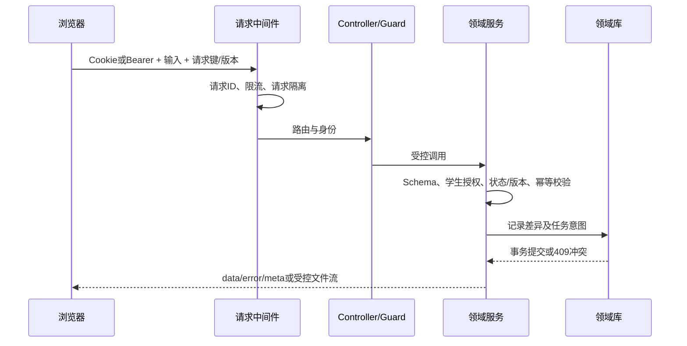

# 核心业务详细设计

本文补充 [105项功能实现目录](01-functional-framework.md) 中跨模块的处理顺序、算法和失败行为。各接口完整参数签名与实现行号见 [接口索引](generated/api-reference.md)。

## 1. 通用请求与事务

统一首页`GET /learning/home`是只读聚合：明确选择档案时先检查授权，不能以列表第一项替代无效选择；读取当前范围、今日安排和证据记忆，优先提供未完成评测、到期复测、监护决定、训练和课堂断点。链接指向已有对象，打开首页不创建活动。浏览器以显式URL优先、按主体隔离的标签页选择其次，校验缓存结构；切换时清空旧数据并取消请求，过期响应不能覆盖新档案。完整行为见 [E01交付](../product/experience/implementation-log.md)。

Controller负责HTTP适配和部分角色门禁，具体学生权限、业务状态、输入Schema及版本检查分布在领域服务。`ApiResponseInterceptor`在成功处理后调用`commitRequest`，提交成功后才形成普通JSON响应。文件流保持`StreamableFile`，不套业务JSON。

`requestKey`是业务级幂等键，不是全局万能防重。各服务按主体、业务类型、对象或会话保存请求摘要；同键同输入返回既有结果，同键不同输入应冲突。某些老兼容操作仅有状态约束，不能声称所有写接口已经统一相同幂等协议。

## 2. 范围确认与定义兼容

输入包含`studentId + subject + grade + term + textbookVersion + progressMode + learnedAtomIds/selectedLessonIds + minutesPerSession`。家长确认产生独立版本；学生通过提议流程提交候选。

教材模式先读取版本化登记和章节，再使用已批准`TextbookAtomMapping`得到知识范围，并保存教材修订、所选课时和映射快照。尚未映射课时写入缺口，不能依赖同年级或关键词猜测已学内容。

知识定义指纹覆盖测量语义。测量映射和题面具有各自内容指纹；新评测只接纳仍与当前定义/内容匹配的已审核映射。旧会话使用冻结版本，旧报告可以展示，但与当前定义不可比的证据不直接汇入新画像或新指导计划。

相关实现：[CurriculumService](../../apps/api/src/modules/diagnostics/curriculum.service.ts)、[measurement-definition.ts](../../apps/api/src/modules/diagnostics/measurement-definition.ts)、[TextbookRegistryService](../../apps/api/src/modules/diagnostics/textbook-registry.service.ts)。

## 3. 蓝图与选题算法

### 3.1 资格过滤

候选题需要同时满足当前范围、知识和题目版本、映射审核、发布与来源资格、可用作答协议、当前媒体能力等条件。需要追溯先修时，在蓝图中明确标为基础核查，不将未确认的新教学目标偷偷混入。

### 3.2 六类策略

- 起点评测`baseline`：默认12题，上限30，最多20分钟。
- 单元`unit`：默认8题，上限20，最多15分钟。
- 阶段`phase`：默认20题，上限30，最多25分钟。
- 微测`micro`：默认4题，上限6，最多3分钟。
- 原因核查`verification`：默认6题，上限12，最多10分钟。
- 间隔复测`retest`：默认4题，上限8，最多10分钟。

最终预算还受本次请求和已确认时长限制。预计秒数来自素材标注，是学习负担预算，不是速度常模。一、二年级每组2题，其他年级每组3题。

### 3.3 选择顺序

在各目标知识点间轮询，排除已选相同题目及本点重复规范题族，并核对累计预计时间。排序优先未见过题、适用的基础锚点、未覆盖维度、策略维度顺序、难度和种子哈希排名。随机种子使同一冻结输入可重放。

原因核查使用单独验证组选择器，先确保各观察组所需的知识点、维度和独立题族。停止原因可能是验证组已满足、题量预算、时间预算或独立题族不足。覆盖不足在蓝图和报告中保留。

### 3.4 预览与确认

`diagnosticBlueprints`保存30分钟。开始前重新计算范围、题面、定义、曝光与指纹；任何影响题组的变化需要重新预览。成功开始保存题目/映射/答案/量规/知识快照和请求回执，不从当前题库动态替换进行中题目。

实现：[assessment-blueprint.ts](../../apps/api/src/modules/diagnostics/assessment-blueprint.ts)、[verification-blueprint.ts](../../apps/api/src/modules/diagnostics/verification-blueprint.ts)、[DiagnosticsService](../../apps/api/src/modules/diagnostics/diagnostics.service.ts)。

## 4. 冻结范围内的自适应路由

自适应改变本组已有题目的顺序，不改变本组已确认题量和范围。

1. 开始选择目标知识点的基础理解或操作锚点。
2. 上一题待复核、提示后回答、曝光、跳过或不会时，不按独立对错分支，补充同点基础对照。
3. 基础独立失败时，优先冻结集合里最近的尚未核查先修点；没有合适先修则做同点不同题族对照。
4. 迁移独立失败时返回同点基础，观察是否是表示转换差异。
5. 基础独立成功时尝试迁移；先修核查成功后返回原目标，仍不直接宣布原因解决。
6. 无专门分支可用时，选择本组观察较少的目标并记录覆盖理由。

每步保存`rule/reason/basis/focusAtomId`。复测采用固定题组，避免把动态路径差异混成可比保持结果。

实现：[adaptive-routing.ts](../../apps/api/src/modules/diagnostics/adaptive-routing.ts)。

## 5. 作答、提示与评分

### 5.1 统一答案信封

现代响应采用`{ questionId, mode, response }`。草稿和最终响应使用同一协议族，草稿允许部分完成；最终提交要求合法完整结构。旧标量输入有兼容处理，但不能跳过现代题目配置校验。

当前17种模式：

- `single_choice`、`multiple_choice`、`boolean`：单选、多选、判断。
- `text_blank`、`numeric_blank`、`formula_blank`、`multi_blank`：文本、数值、公式、多空。
- `table_fill`、`matching`、`sorting`、`drag_drop`、`hotspot`：表格、配对、排序、分组拖放、热点。
- `geometry_draw`、`stepwise`、`image_upload`、`short_answer`、`audio_record`：绘图、分步、图片、短答、录音。

公开配置只包含互动数据，私有评分键不返回控件。禁止危险键名、超长载荷和无界笔迹；绘图坐标规范到0–1。具体字段见 [answer-protocol.ts](../../packages/contracts/src/answer-protocol.ts)。

### 5.2 响应事实

`answered`、`skip`、`dont_know`分别表示作答、跳过和自报不会。保存首次响应、耗时、提示等级、曝光、题目/映射版本和提交时间。重复提交不产生新独立样本。暂停保存草稿；提前结束只评估已答证据。

### 5.3 判分与复核

`gradeResponse`先检查协议，再做受限文本归一、数值/分数解析、容差、单位、集合及各模式的确定性比较；公式仅使用受限算术解析，不执行输入代码。多空、表格和结构题可产生逐项`scoreDetails`。

空白输入不能转成0。步骤、短答、绘图、图片和录音进入`pending_review`；标准答案与冻结协议不一致也进入内容复核。授权教师按冻结量规追加`ScoringRevision`，原始答案与原报告保留。

实现：[scoring.ts](../../apps/api/src/modules/diagnostics/scoring.ts)、[scoring-review.ts](../../apps/api/src/modules/diagnostics/scoring-review.ts)、[ReviewsService](../../apps/api/src/modules/reviews/reviews.service.ts)。

## 6. 掌握估计的实际公式

算法版本为`rule-estimate-v2`，是规则化概率估计，并未经过学生人群常模标定。

### 6.1 证据权重

只有已评分、有效审核映射、未提前曝光的响应参与。按提交时间去重同一学生/知识点/题目/题目版本；题族通过规范化身份判断独立性。

`w = mappingWeight × hintWeight × familyWeight × 2^(-ageDays / 60)`

- 无提示、一级、二级、三级及以上提示的`hintWeight`分别是`1、0.6、0.3、0`。
- 某独立题族第一条权重系数1，其后为0.5。
- 使用60天半衰期衰减，而不是把旧表现视为永久有效。

### 6.2 后验与区间

令`n = Σw`，`s = Σ(w × score)`：

`a = 1 + s`，`b = 1 + n - s`，估计均值为`100 × a/(a+b)`。

Beta分布的2.5%与97.5%分位构成模型下95%可信区间。实现使用Lanczos log-gamma、连续分式与二分分位求解；这是实际分位计算，不是固定误差条，也不是已验证的人群能力置信保证。

无证据显示`null/unknown`。四条权重均为1的全对证据得到均值约83.3%，并不等于“能力83.3分”或“稳定掌握”。这是计算示例，不是实际学生数据。

### 6.3 状态规则

- `unknown`：有效样本量为0。
- `insufficient`：有效样本小于3，或无提示独立题族少于2。
- `secure`：前述条件满足，并且有效样本至少6、区间下界至少70、迁移与保持均验证。
- 其余均值至少70为`fragile`，否则为`learning`。

迁移验证需要至少两个无提示正确独立题族；保持验证需要至少两个真实间隔至少一天、无提示正确的保持题族。各维度单独输出估计和有效样本。原始正确率、有效样本量和掌握估计是不同指标。

实现：[measurement.ts](../../apps/api/src/modules/diagnostics/measurement.ts)、[family-identity.ts](../../apps/api/src/modules/diagnostics/family-identity.ts)。

## 7. 原子观察、原因假设与验证

### 7.1 原子步骤观察

组合题只有经审核的`ComponentBinding`才能把评分分项关联到子点。`scoreKeys`指定观察字段，`requiresKeys`表明上游条件。系统区分“本步未达标”和“上游阻断，尚不能判断本步”。分项观察用于路由核查，不作为额外独立响应再次计量。

### 7.2 原因规则

- `procedure_gap`：基础理解/操作至少两个独立题族未达标支持继续核查；至少两个达标构成反证。
- `prerequisite_gap`：目标至少两个题族未达标，且某直接先修至少两个题族未达标才支持；每个直接先修各至少两个达标构成反证。
- `representation_gap`：基础至少两个题族达标、迁移至少两个题族未达标，且两组至少四个不同题族才形成支持；迁移独立达标提供反证。
- `retention_gap`：基础成功与真实间隔后的保持失败共同核查；当天反复刷题不能证明保持。

支持和反证同时成立时保持`inconclusive`。当前规则置信级别不提升为高置信医学或智力诊断。每个假设保存观察、解释、替代解释、支持/反证ID、所需探针、规则版本、定义指纹和状态历史。

### 7.3 关闭与重开

同规则版本下，失败后的多个独立成功可使原问题`resolved`；关闭后新失败可`reopened`。规则或题族身份变化需要重新分析，结论变化会注明规则变化，不能自动视为学生进步。

实现：[component-observations.ts](../../apps/api/src/modules/diagnostics/component-observations.ts)、[diagnosis.ts](../../apps/api/src/modules/diagnostics/diagnosis.ts)。

## 8. 指导、练习与复测闭环

正式计划必须来自已完成且定义仍可比的评测。规则优先支持的先修阻断和非稳定点，按每天预算最多选择3个行动，分配时长，冻结证据、批准教学和可核对来源。

AI可补充计划摘要和活动描述；行动ID、知识点、证据、成功标准与资源由服务约束。家长确认后进入今日任务。练习采用新题和冻结行动，提示、复做与主观评分单独保存。

复测按1、3、7、14日安排，支持到期启动与改期。复盘比较可比的知识定义、独立性、迁移和保持；无足够证据则写“待验证”。家长的复盘确认是阅读/决定记录，不是能力测量。

相关实现：[GuidanceService](../../apps/api/src/modules/diagnostics/guidance.service.ts)、[LearningService](../../apps/api/src/modules/learning/learning.service.ts)、[NotebookService](../../apps/api/src/modules/learning/notebook.service.ts)。

## 9. 内容发布与测量资格

整卷发布和单题测量发布相互独立。原卷的缺题槽位、媒体缺失和PDF-only状态不抹平；自动OCR、AI结构化和教材映射候选均需人工审核。发布检查既看审核结论，也看审核所绑定的内容/定义指纹，防止“改内容、沿用旧审核”。

## 10. 工作台与课堂播放器

### 10.1 课程和导航

`/studio`使用`view/student/subject/course`维护当前页面和学习档案；单元与面板保留在查询参数。加载代次丢弃过期响应，切换档案/学科清理旧活动状态。成人课程与学生课程共享导航，课堂学习结束返回原学生、学科、课程、单元和面板。

课程库以`courseQuery/courseState/courseType/courseSource/courseRecent/courseSort`保存组合条件，允许值与长度受控；搜索替换历史条目，条件选择增加条目。当前课时集合与真实记录区分未开始、进行中、讲解已读，不使用课程创建时间冒充学习时间。类型/来源/近7或30天与排序共同作用，空结果可清空。进入成人/小学目录及课堂返回保留条件；GESP按身份提供独立轨道入口。显式无权限档案返回403，不退回另一个孩子。见[课程库交付](../product/94-course-library-continuity.md)。

蓝图先编辑名称/目标、范围内1～30点和5～60分钟预算，再预览来源、资格缺口及全部单元活动。返回修改使旧预览失效；预览取消中止请求且不建课。创建复用完整范围校验并比较指纹，按主体/命令摘要/请求键绑定课程回执；回执丢失后重试恢复原课，范围后来改变不重做原确认。可选`pace`按参考时长分段，各时段不超过预算并链接实际活动；语言沿用已审核素材。具体规则与旧回执边界见[蓝图交付](../product/95-course-blueprint-editor.md)。

### 10.2 播放与中断

课件由`ClassroomStep`组成，讲稿与板书blocks分离。`cursor`指当前步骤，`revealed`指已揭示步骤，`sentenceCursor`指当前句。每句单独请求音频，结束后推进；只预取下一句。静音使用阅读节奏；暂停停止自动推进；刷新恢复持久断点，当前句从头继续。

板书要点、图片和表格按项出现。对话历史保存讲稿与插问，板书不主要采用逐字打字。插问暂停课程，返回受控要点或三标签关系图。练习助教看到当前题面而看不到私有答案键，调用后保存辅助标记。

### 10.3 两种代码运行

课堂的JavaScript示例在独立runner与Worker中运行，CSP限制网络，超时停止，不作为服务端代码执行。GESP C++则在Linux/WSL隔离工具链执行，两者语言、权限和证据完全不同。

### 10.4 导出

课堂导出已读板书和插问Markdown，打印可保存PDF。自由白板通过Canvas与MediaRecorder导出WebM，可叠加逐幕语音并导出SRT。音频上下文和媒体轨道在结束时释放。导出需要浏览器能力，且不自动生成新的能力证据。

### 10.5 练习、单元新情境与版本恢复

微课包含182道课堂题，五单元另有60道新情境题，逐一对应60个主题。组装时校验主题覆盖、选项与答案，并稳定打乱选项；单元版本摘要含私有评分定义。题目主题和目的公开，答案与解释冻结于服务端会话，提交后才返回解释。

首课5题，其余59课各3题；30表格题与2图示题分布五单元。两级提示冻结在私有`hintKeys`，公开仅返回级数和已读`hintReceipts`；指定level顺序读取，重放或新键重读同级均不升级。`disposition`区分answered/skip/dont_know，旧空答案仍按skip处理；首次回执冻结提示级别，不会不计为答错或跳过。独立练习失败可见，重试清除旧连接错误。

当前练习版本包含私有答案/提示摘要；另以讲解目标、步骤和验证入口的严格内容身份计算`readingProgress`。练习更新时可保留完全相同讲解的旧已读事实，不能将旧单题结果复制为新三题组表现。旧会话缺少提示表时仅使用其冻结原提示。完整实现及证据见[Practice交付](../product/96-classroom-practice-and-progressive-help.md)。

`POST /learning/classroom/sessions/:id/hints`先保存提示事件再显示帮助，校验会话/题目权限和请求重放。作答合并服务端辅助事实，客户端不能用false清除；首次答案锁定。共享`classroomPracticeSummary`仅计算冻结题组首次回执，区分独立正确、答错、跳过、不会、辅助与未答。重开到首个未答题，全部完成则显示复盘；可回看解释和返回对应微课，不推断稳定掌握。

会话地址包含具体`session`，GET恢复原快照并校验lesson/course一致性。仅有旧版本时普通入口恢复旧记录，明确提交`useCurrentVersion:true`才开新版；目录提供当前账号旧记录。旧题按冻结量规评分，新题不能混入旧卷。详见[本批交付](../product/93-classroom-unit-checks-and-review.md)。

## 11. PDF与模型结构复核

上传PDF先存受控原件并进入持久任务。Python输出原页图、文字层/OCR文字、bbox、置信度和段落/表格/公式候选。需要模型复核的页最多选8页送小九CLI；结果按页合并，不覆盖原始页图。

表格使用可选择的HTML单元格，公式由LaTeX候选通过KaTeX显示。用户必须对照原页确认；内容变化时旧`expectedUpdatedAt`不能确认新结构。模型失败仍可展示本地候选并重试。页码匹配可能只是关键词候选，不能宣称人工批准引用。

## 12. 日历与ICS

月视图生成实际4–6周网格，周视图7天；本地日期用于选中日和时间呈现，持久事件使用ISO时间；全天事件按结束日排他处理。URL保存`date/mode/tasks`，刷新恢复。

手动事件用`revision`控制编辑，支持已确认/待处理、完成/重开、内容和时间修改。批删在任何删除前校验全部ID、学生权限和手动事件资格；切换日期、视图或筛选清空批选。

计划事件必须通过计划的`expectedRevision`更新，订阅事件只读。ICS连接校验公网HTTPS、重定向与体积并加密订阅地址，按来源与UID刷新。当前是手动刷新与文件互通，没有学校原生OAuth或双向成绩回写。

## 13. AI调用分工与失败处理

- 模型目录合并小九本机配置与兼容列表，Auto解析为默认`deepseek-v4-flash`，界面标为DeepSeek V4.1 Flash。
- 普通聊天与课堂插问通过小九CLI的临时只读调用，输出JSON Schema；服务层验证引用与板书。网页当前不是逐token流式返回。
- 指导/分析保留部分OpenAI兼容实现；有些路径有规则降级，有些能力缺配置直接不可用。不能统一宣称全部AI都已经由一个渠道承担。
- 语音优先MiniMax，解析流式PCM后返回完整WAV；只有未配置MiniMax时才选择已配置OpenAI语音。失败不静默切换另一付费供应商。
- 两张课程位图通过开发期生图资产流程生成并随工程保存；产品运行时尚不按每次问题在线生成新图。

AI可以解释和提议，不能直接替学生答题、改变确定性评分、写入稳定掌握状态或跳过教研发布门禁。

## 14. 项目阶段、量规与修订

显式开始项目后冻结目标、阶段字段、四级量规和指纹。草稿保存允许不完整字段和证据，自评准备一起保存；提交检查阶段字段、证据及全部维度依据，冻结作品并指向前一提交。后续编辑不修改旧快照，再次提交要求修订说明。重复命令先按请求键与摘要重放；新的命令再检查修订号，冲突不覆盖已保存稿。

学生只写自己的项目，绑定家长或当前授权教师可查看孩子产物并复核指定提交；成人不能登记自己的作品为人工审核。AI只返回已保存稿的建议，取消不追加，修改后保留其针对旧稿的身份。旧课堂草稿主动复制成参考，原件不清空；所有项目结果不进入诊断掌握度。详见[项目规格与交付](../product/97-versioned-course-projects.md)。
