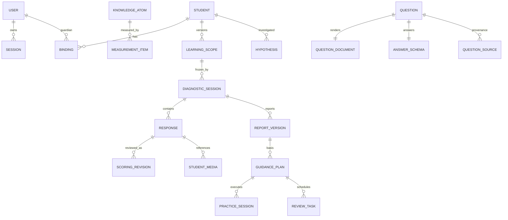
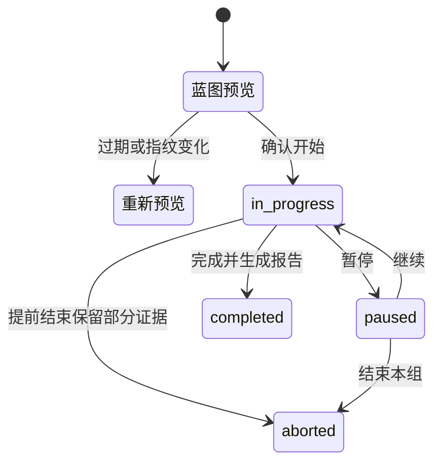
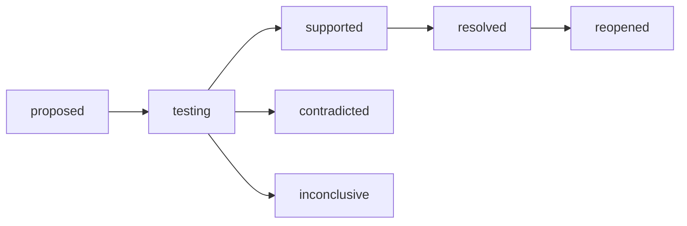
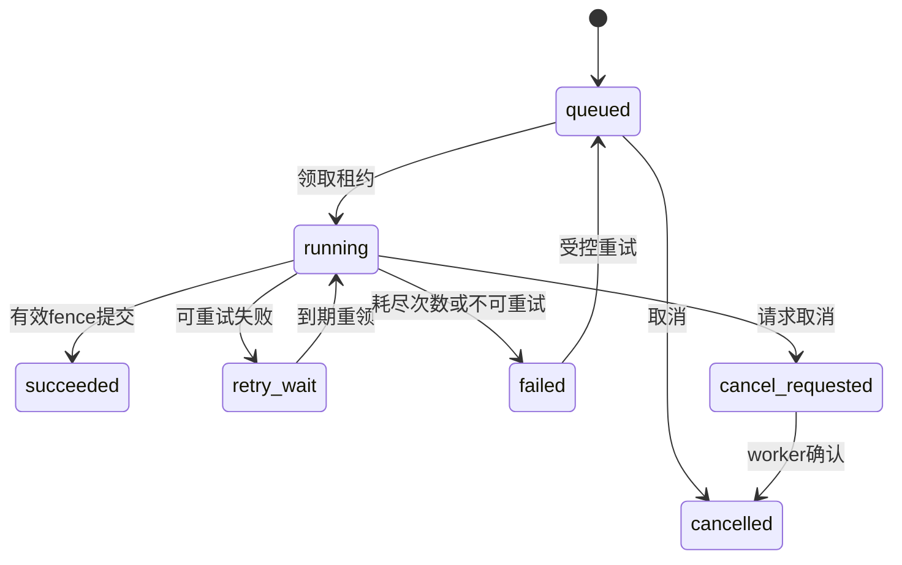

# 数据与状态设计

完整81个领域集合及共享类型字段见 [数据索引](generated/data-reference.md)。本文解释逻辑关系、数据库承载、证据冻结、状态和一致性。图中的关系是业务关系，不表示全部已建成SQL外键。

## 1. 三类存储

### 1.1 可变业务领域库

`DomainDatabase`支持SQLite和PostgreSQL。领域对象主要存入`domain_records`，以`collection + record_id`定位，`body`保存JSON/JSONB，`position`维护稳定顺序。`InMemoryStoreService`是历史注入名称，实际正式运行使用数据库事务，并非服务重启即丢失的纯内存数组。

当前迁移代码登记至版本12，不能继续使用早期文档中的版本8作为现状。主要表包括：

- `schema_migrations(version, applied_at)`：迁移登记。
- `store_meta(id, revision)`：全库版本。
- `domain_records(collection, record_id, body, position)`：领域文档。
- `domain_collection_versions(collection, revision)`：集合级版本与按需刷新。
- `durable_tasks`：任务载荷、状态、尝试次数、租约、栅栏、进度与结果。
- `durable_task_history`：任务历史。
- `request_rate_limits(bucket_key, used, expires_at)`：原子额度。
- `study_restore_guard`：恢复状态栅栏。

唯一约束覆盖账号、会话令牌、有效绑定、学习身份/码、助教作用域与请求、隐私请求、媒体请求、GESP提交/提示/指导/审核等。不是所有领域约束都依赖SQL唯一键，部分由事务内服务校验和读取依赖共同完成。

### 1.2 独立只读研究索引

原始试卷使用资产根的`catalog.sqlite3`、`manifest.sqlite3`和`shijuanbao/archive.sqlite3`。目录负责过滤与FTS检索，archive保留原始题卷和压缩题目，manifest记录独立复制校验。原始媒体必须同时满足来源记录和迁入清单。

GESP使用独立`data/gesp/catalog.sqlite3`及版本化资源哈希。大库不经领域兼容数组全量加载。研究资产可以完整归档，学生发布资格另由业务记录决定。

### 1.3 文件与浏览器状态

- 学生规范化图片/录音位于业务数据目录的`student-media`，随业务备份。
- 原始资产位于`STUDY_ASSET_ROOT`，题卷、教材和媒体各有索引/清单。
- 工作台PDF、页图和处理缓存使用受控资料存储；API按逻辑ID访问，不按用户提交任意绝对路径读取。
- 课堂显示偏好、导览状态等可存浏览器本地；正式学习会话、答案、项目已保存草稿和消息在服务端。
- 隐私归档准备句柄是进程内短期状态，重启后需重新准备；它不是可恢复学习事实。

## 2. 核心实体关系

这些关系共同提供可追溯链：学生 → 范围/定义 → 题目与评分版本 → 作答 → 有效评分 → 报告 → 原因 → 行动 → 训练/复测 → 复盘。

## 3. 数据域与主键关系

### 3.1 身份与家庭

`users`保存账号、角色、状态与密码哈希；`sessions`保存令牌摘要、主体、学生身份、创建/到期/撤销时间。`students`是孩子档案，不能拿`userId`或学生ID直接推导监护权。

`bindings`连接家长与孩子；`studentInvitations`保存受邀对象和一次性消费；`teacherAssignments`保存指定学生复核授权。`studentLearningAccess`、`studentLearningCodes`、`studentAccessRevisions`形成受限学习身份的版本链。

### 3.2 课程与范围

基础`textbookVolumes/Units/Lessons/knowledgePoints/questions`与当前`knowledgeAtoms/measurementItems/learningScopes/textbookAtomMappings`分开保存。

`KnowledgeAtom`关键字段：`subject/name/strand/grade/term/objective/successCriterion/prerequisiteIds/curriculumVersion/status/version`，可含父点、易混、迁移和教学卡。

`LearningScope`关键字段：`studentId/subject/grade/term/textbookVolumeId/textbookVersion/learnedAtomIds/currentAtomId/minutesPerSession/version/confirmedAt`，教材模式附章节与映射快照。

`MeasurementItem`绑定`questionId/questionVersion/atomId/dimension/family/probeRole/expectedSeconds/difficulty/reviewStatus/mappingWeight/observationCode/version`和内容/定义指纹，可附原子分项绑定。

### 3.3 评测与报告

- `diagnosticBlueprints`：主体、命令、指纹、预览、有效期与已启动sessionId，敏感内部字段不全部返回前端。
- `diagnosticSessions`：范围、知识、题目、映射、答案和量规快照；题序、状态、版本与路由历史。
- `diagnosticDrafts/diagnosticHints`：恢复作答和辅助事实。
- `diagnosticResponses`：首次输入、处置、评分、时间、提示、曝光及版本。
- `scoringRevisions`：追加式量规修订；`diagnosticReports`保存带version的报告对象。
- `diagnosticHypotheses`：原因类型、规则版本、知识指纹、支持/反证/自报ID和状态历史。

`MasteryEstimate`是从有效证据计算并进入报告的结构，不是一个可由前端任意修改的“分数表”。它包含均值、上下界、有效样本、题族、各维度、独立性、验证标志与算法版本。

### 3.4 指导、训练和错题

`diagnosticPlans/guidancePlanRevisions/reviewTasks`保存正式计划及复测；`practiceSessions`冻结行动与题目，`practiceAttempts/practiceHints/practiceScoringRevisions`记录训练事实。

`mistakeNotebookEntries`引用原`diagnostic`或`practice`响应，并追加标签、反思、收藏、移除状态、复做会话及新题验证蓝图。组织错题不修改原始作答。

### 3.5 工作台与课堂

`studioCourses`按档案/学科保存课程；列表中的`learningProgress`由当前主体的课堂会话派生，不能把家长的课堂阅读复制成学生的能力证据。

新课程可带`pace`，保存估计版本、单次预算、材料语言、总参考时长及活动分段；既有无该字段的记录保持可读。课程创建活动新增可选`actorId/requestHash/referenceId`，将同一确认命令绑定原课程；重放先复核当前访问权限，不能把后来变化的范围替换为一次新的创建。旧记录缺少绑定字段时要求重新预览，不猜测原命令。

`classroomSessions`同时保存课件快照、私有答案键、请求回执、步骤/句子断点、消息、练习和项目草稿。公开视图移除私有答案键与内部请求表。成人课程以固定courseId隔离，孩子批准课堂带studentId及studioCourseId。

`courseProjects`按账号、课程和单元隔离，冻结项目与量规内容指纹。阶段草稿和自评准备可更新；提交快照、前一版本身份、人工复核与建议追加保留。修订号防止旧页面覆盖，命令摘要和请求键实现重放；公开视图移除内部请求表。旧课堂草稿复制到参考区而非替换原件。新集合纳入学生/账号导出与删除，不进入正式测量样本。

课堂新增可选私有`hintKeys`与公开已读`hintReceipts`，逐级正文和实际时间先持久化再返回；原始题面hint在公开视图置空。作答回执可带disposition与hintLevel，保留旧skip语义；旧布尔辅助事实不被猜为某一级提示或时间。当前练习与严格兼容的讲解阅读分开聚合，均不修改原始会话快照。

`studioWhiteboards/studioSourceMaterials/studioLearningPacks/studioStudyPlans/studioActivities`分别保存白板、PDF资料、学案、排程和活动。`studioConnectors`中的订阅URL加密，响应剔除敏感字段；`studioScheduleEvents`是任务和外部事件的统一呈现模型。

### 3.6 GESP

`gespLearningScopes`及修订保存独立编程范围；`gespProbeSubmissions/gespCodeSubmissions/gespHintEvents`保留概念、实现与辅助事实；`gespGuidancePlans`及修订和`gespReviewTasks`支持确认式指导和保持；`gespTaskReviews`及修订绑定内容哈希。

### 3.7 内容、文件、复核与隐私

`questionDocuments/questionAnswerSchemas/questionSources/questionImportJobs/questionImportRecords`是题目三件套与导入；`measurementCandidates`是原卷测量发布中间态；`paperPublications/libraryBookmarks`是整卷可见性与个人组织。

`importFiles/processingArtifacts/importPages/studentMedia`记录文件与证据引用。`evidenceFeedback`保存异议而不自动改分；`privacyRequests`保存操作回执。`events`保存领域事件。

### 3.8 历史保留集合

`assessments/assessmentAnswers/assessmentResults/studyPlans/missions/missionAnswers`来自旧原型。保留它们是为了历史与迁移，并不恢复已退役写接口。早期统计和管理员历史视图仍可引用。

## 4. 状态机

### 4.1 正式评测

答案记录还有`scored/pending_review/skipped`等评分/处置维度，不能用会话completed推断所有主观作答已经复核。报告可以在复核或规则重算后追加新版本。

### 4.2 原因与干预

这是主要业务关系，不是任意点击的自由状态编辑器。服务根据题族、支持与反证重新计算；规则版本、后续时间条件及部分兼容状态也会影响迁移。

### 4.3 后台任务

任务采用可重试执行与幂等结果，而不是对所有外部副作用声称exactly-once。旧worker持有过期leaseToken时不能提交。

### 4.4 日历

手动任务有两个正交字段：`confirmed`表示确认/待处理，`status`表示`scheduled/completed/skipped`。编辑使用`revision`。来源为订阅的事件只读，带`planId`的事件通过计划会话更新，不能用手动任务接口任意改写或批删。

### 4.5 媒体与资料

媒体从创建上传、接收分块、完成规范化，到绑定响应或取消/过期回收；是否已完成上传与是否已绑定答案分别判断。PDF资料具有`queued/processing/ready/needs_review/failed`等处理状态，恢复结构的人工确认与知识教学审核仍是不同状态。

### 4.6 资料课程

`studioSourceMaterials`增加明确所有者及pdf/text类型；私人资料studentId/subject为null。`sourceCourses`保留输入、目标、冻结来源、候选/原始结果、模型、修订、请求回执与任务ID。状态为queued → generating → ready → active → archived；任务失败/取消由实际任务状态推导，授权重试回到queued。生成内容不因确认而成为教师批准内容。

`classroomSessions.sourceCourseId`连接来源课，但课文、答案与两级帮助仍冻结在会话内。portable导出剔除生成私有结果、课堂answerKeys/hintKeys及内部请求表；TAR另加入按SHA-256验证的原始PDF。账号关闭保留共同监护孩子的已确认来源课并匿名署名。无引用PDF物理字节清理尚未接入，不能将元数据删除称为完整物理擦除。

## 5. 版本和并发语义

- `version`常用于定义、课程/映射和内容审核；`revision`常用于运行会话、计划或日程。
- `requestKey + inputHash`负责重放，`expectedRevision/expectedVersion/expectedUpdatedAt`负责防止覆盖旧状态，两者不能互换。
- `contentFingerprint`冻结内容，`atomDefinitionFingerprint`冻结测量语义，题族身份版本负责独立性口径。
- 数据库读取依赖既包括具体记录，也包括匹配集合的成员；授权撤销、集合新增或同记录修改会影响提交资格。
- SQLite/PG提交差异而非每次覆盖整库，跨家庭独立事务可以合并；冲突时返回409，由界面刷新核对而非盲重试覆盖。

## 6. 隐私、导出与删除约束

公开题目不含答案键，公开课堂视图剔除私有评分和请求记录；导出接口还会移除身份秘密和内部字段。请求Schema和服务授权必须在文件访问时再次执行，不能只在列表阶段检查。

删除先生成影响预览与指纹，再重新验证密码和确认文本。共同监护档案中的学习事实保留规则与账号关闭分开；恢复旧备份时应用独立删除账本，防止已删除资料重新出现。离线副本和历史备份仍需保留策略管理。

## 7. 数据设计已知取舍

领域JSON文档便于保存异构协议与历史快照，也意味着跨实体约束不能全由传统外键承担。当前用服务校验、事务、读取依赖、唯一索引和专项恢复测试共同保证；需要更大规模时，应先度量查询与快照开销，再决定拆表或专用仓储，不能只因类名InMemory而误判持久化现状。

### 7.1 来源稿修订的额外事实

`sourceCourses.authoringExposedAt`保留成人创建者首次打开完整答案或提交完整修订的时刻，不改写原始生成结果。`classroomSessions.authoringAnswerExposure`及`ClassroomAnswerReceipt.answerExposure`冻结这一已知辅助事实，与hintUsed分别保存；旧记录缺失时不猜测。修改标题/目标不自动等同已见答案。原始私有生成稿与完整修订流水不进入普通portable输出。

候选编辑与确认仍是两步；编辑内容不会把contentReview从pending改成教师审核通过。详细版本与来源约束见[资料课程稿件](../product/99-source-course-content-editor.md)。

### 7.2 分课检查点身份

`sourceCourses.generation`保存私有原始输入与捕获方式、流水线版本、路线、逐课初稿/复核稿、阶段时间、实际模型与摘要。输入和内容摘要对对象键排序，保持数组顺序，避免PG JSONB重排对象键后把相同检查点误判为不兼容。原有内容身份继续沿用其原版本规则。

checkpoint与completion两种TaskFence都在领域数据库的同一事务检查任务ID、token、running与未过期租约；checkpoint保留任务与租约，只写安全计数，completion结束任务。心跳省略progress时只续租，不覆盖原子检查点。普通课程视图与portable导出不包含私有逐课初稿或问题摘录；显式作者入口才取得完整复核详情。详见[分课流水线](../product/100-source-course-generation-pipeline.md)。

### 7.3 课堂参考图的版本与文件生命周期

`classroomVisuals`独立保存会话/节点与冻结身份、请求摘要、用途/提示词、模型、任务、候选文件和个人选用事实。迁移13约束同一账号的请求键；选用读取完整节点版本组，通过事务读取依赖处理并发，不使用会在逐行替换顺序中误拒绝合法切换的单行唯一选用索引。选用不修改课堂cursor、修订号、作答或掌握度。

每个租约使用自己的暂存目录；解码成固定1024方图PNG、去除展示图元数据并核验哈希后，才在最终领域事务中发布。取消请求与实际停止分开显示。晚到/撤权/过期任务不能发布；失败重试保留同一候选版本。下载和选用前再次核验字节，损坏图片仍允许取消选用。

完整备份保存原图、展示图、私有提示词；家庭导出仅包含有权取得的原图和展示字节及公开生成记录。删除先提交事实，再排持久回收任务；孤儿与过期暂存采用一小时宽限，保留当前租约目录，避免并发快照误删刚生成的目录。恢复旧备份先应用删除账本。
