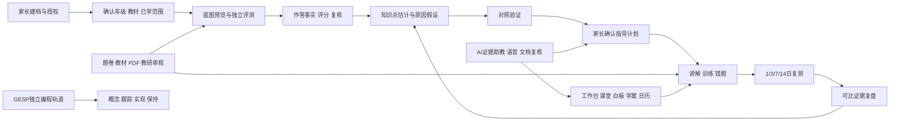

# StudyAgent 当前功能与设计总册

整理日期：2026-10-26。当前课堂实现包含[107持久插问](../product/107-classroom-turns-and-reference-state-parity.md)、[108代码实验](../product/108-classroom-code-experiments-and-draft-recovery.md)、[110资料课程版本](../product/110-source-course-revisions-and-lifecycle.md)、[111真实项目文件](../product/111-project-attachments-and-frozen-file-evidence.md)、[112可恢复作答](../product/112-recoverable-answer-drafts-and-complete-input-journeys.md)和[109图表/公式/节奏](../product/109-classroom-comparison-formulas-and-reply-pacing.md)；原件恢复见[交付106](../product/106-original-repair-product-delivery.md)。源码基线、验证与守护运行版本分别以各批收据为准，开发接入不自动等于运行交付。完整范围与剩余里程碑见[计划105](../product/105-development-plan-status-and-next-milestones.md)。

这套文档回答“当前产品有什么、各能力怎样协作、每项功能具体怎样实现”。事实以当前接入代码、共享契约和测试为准；此前九十多份交付文档作为沿革与验证证据保留。

普通助教已支持持久任务、明确取消、完整原问题恢复、分页检索和原题定位，详见[具体规格](../product/113-durable-assistant-conversations-and-history.md)及[验收收据](../evidence/2026-10-25/assistant-turn-acceptance.json)。源码、精确CI与实际守护运行版本分别记录，当前119状态见本页末尾，不以设计生成代替发布。

## 阅读入口

- [功能框架](01-functional-framework.md)：14个领域、120项功能，包含角色、入口、能力和限制。
- [概要设计](02-high-level-design.md)：产品边界、角色、架构、模块依赖、业务闭环和关键设计决策。
- [核心详细设计](03-core-detailed-design.md)：范围、组题、评分、能力估计、原因验证、指导、AI、课堂和日历的处理细节。
- [数据与状态设计](04-data-and-state-design.md)：实体关系、95个领域集合、SQL结构、版本与状态机。
- [运行、资产与质量设计](05-runtime-assets-and-quality.md)：依赖、AI通道、处理链、部署、备份恢复、测试与当前证据。
- [完成边界与待完善项](06-boundaries-and-follow-ups.md)：已实现、历史保留、待验证和明确不做的范围。
- [离线功能浏览器](index.html)：按领域或关键词查找功能，展开输入、处理、输出、接口、数据与代码。

## 逐领域详细设计

1. [身份、家庭与学习权限](details/01-identity.md)
2. [知识、教材、范围与课程版本](details/02-curriculum.md)
3. [评测组题、作答与评分](details/03-assessment.md)
4. [掌握量化、原子观察与深层原因](details/04-measurement.md)
5. [指导计划、训练编排与间隔复盘](details/05-guidance.md)
6. [家庭首页、今日训练、学习记忆与错题](details/06-learning.md)
7. [题卷资产、内容编辑、导入与发布](details/07-content.md)
8. [大模型、证据助教、语音与文档模型](details/08-ai.md)
9. [学习工作台、实时课堂、白板、学案与日历](details/09-studio.md)
10. [GESP研究、C++试点与独立保持](details/10-gesp.md)
11. [主观复核、异常反馈与质量闭环](details/11-review.md)
12. [作答图片、录音与受控媒体](details/12-media.md)
13. [家庭资料下载、删除与恢复约束](details/13-privacy.md)
14. [持久化、后台处理、监控、部署与质量](details/14-operations.md)

每项功能均注明输入、处理步骤、输出、持久化集合、权限/失败/限制、接口和实际服务方法；内部算法与浏览器交互明确标识为非独立API能力。

## 开发查阅索引

- [全部接口](generated/api-reference.md)：358个源码路由声明中，当前正常接入337个、旧协议410拦截8个、未接入历史声明13个。正常接口数包含健康和运维接口。
- [页面职责](generated/page-reference.md)：26个页面和1个课堂runner处理器；部分页面是兼容重定向。
- [领域集合与316个共享类型](generated/data-reference.md)：逻辑集合不等于SQL表，Zod推导类型须继续查看源Schema。
- [功能目录JSON](feature-catalog.json)、[源码结构JSON](generated/source-inventory.json)、[接口覆盖检查](generated/coverage.json)、[整理验证收据](generated/design-validation.json)。

## 端到端产品结构



## 使用口径

“实现”指存在接入的功能与相应代码，并明确依赖和限制。它不自动表示已完成真人教学验证、全教材映射、标准化测量效度、所有设备验收或HyperKnow逐像素一致。读取进度、课堂练习、排程完成与独立测量证据分别保存。

本册仅整理设计与查阅工具，不修改运行中的业务服务、真实家庭数据、模型配置或密钥。

## 更新方法

在仓库根目录执行：

```powershell
node scripts/architecture/project-design-inventory.cjs
node scripts/architecture/build-project-design.cjs
node scripts/qa/audit-authored-curriculum.cjs data/qa/project-design-authored-audit.json
node scripts/architecture/project-content-snapshot.cjs
node scripts/architecture/validate-project-design.cjs doc/evidence/2026-10-24/material-collection-acceptance.json
npm run qa:docs
```

第一步从TypeScript AST提取实际模块依赖、路由、服务签名、集合与契约；第二步生成详细设计与离线浏览器，将人工维护的功能解释与源码交叉核对，发现缺失文件、未接入接口或未覆盖的当前API时失败。内容审计需要当前API编译产物；仅重新生成结构和功能说明时，不必重建服务。验证脚本使用已安装的Playwright Chromium，不启动API或读取家庭数据库。

功能叙述维护于 [project-feature-definitions.cjs](../../scripts/architecture/project-feature-definitions.cjs)，查阅页模板维护于 [project-design-viewer.html](../../scripts/architecture/project-design-viewer.html)。概要与核心算法文档需随业务变化人工核对，自动提取不能代替设计审查。

115候选新增课堂单选/多选、提交后逐项反馈和按账号/冻结会话保存的原选择/提交恢复。当前245题含三个微课多选和一个单元多选，自动化与教师审核分开；详见[115规格](../product/115-classroom-multiple-choice-and-submitted-feedback.md)。113已完成精确CI与守护交付，115当前运行状态以其最终收据为准。

2026-10-26运行交付：118项目逐步教学、标签页独立完整草稿与本人原操作恢复已上线，应用代码944d93a；1178项API通过/39环境跳过、PG14项通过、真实配置MiniMax单句HTTP及解码通过。完整194项浏览器通过，精确CI 8b547d2/40213523846成功；实际构建e558ea4、28项HTTP检查与六音频SHA通过，三次守护观察跨201764毫秒稳定。静态设计当前14领域/118功能/325正常路由/93集合/307共享类型。完整范围及限制见[118规格](../product/118-guided-project-teaching-and-step-navigation.md)和[本批收据](../evidence/2026-10-26/project-teaching-acceptance.json)。


119开发候选：资料课程三阶段项目、逐课/单元学习旅程、准确会话断点、个人项目步骤/模式已接入。当前静态设计为14领域/119功能/325正常接口/93集合/310共享类型，完整API1194通过/40环境跳过、浏览器203通过/0失败/0重试，PG组合31通过/1跳过；精确CI与运行仍待完成，状态以[本批收据](../evidence/2026-10-26/course-journey-acceptance.json)为准。资料独立单元核查未设置，全课程和真人门禁继续保留。


119当前门禁：首个远端CI虽成功，但浏览器202常规通过/1重试通过；连续返回的真实竞态已修正3537dfa，受控六项全通过。固定Web的205本地全量与新精确CI并行核验中，尚未替换118守护运行版；详细证据以119本批收据为准。


119当前运行：资料课程三阶段项目、成人/资料课程学习旅程、准确原句/题目断点、个人项目步骤/模式和连续返回修正已交付。源码索引3537dfa，API/契约主增量466220d；本地与精确CI 9053f03/40221345190的205项浏览器均零失败/零重试。实际构建c1c6608、buildId hi7VwKIGYaHmzQtuQqKdz，51项运行检查/六音频SHA及跨181042毫秒守护观察通过。当前14领域/119功能/325正常接口/93集合/310共享类型，完整范围仍以[119最终收据](../evidence/2026-10-26/course-journey-acceptance.json)及[计划105](../product/105-development-plan-status-and-next-milestones.md)为准；独立资料核查和所有真人/全内容门禁未因此完成。


2026-10-26：120开发分支已接资料独立核查、完整编审、未曝光确认、冻结学生课堂与原文、原命令/本机稿恢复及版本旅程。源码设计更新为14领域/120功能/337正常接口/95集合/316共享类型，142 API测试文件和29浏览器测试文件。完整API1240通过/43环境跳过、PG24通过、九浏览器专项零重试通过，真实默认DS生成6题（首次提示条数校验失败后修正，实际3次模型调用、AI复核修订2处）。其后可读原稿和归档候选只读优化已通过Web类型检查，整站浏览器正在核对；精确CI和守护发布尚未完成，实际运行仍为119。设计验证包含435源码引用、2800 Markdown链接及10离线界面检查，不能替代业务验收。见[规格120](../product/120-source-course-independent-unit-checks.md)与[整合收据](../evidence/2026-10-26/source-check-acceptance.json)。

2026-10-26当前运行已交付120资料课程独立核查：源码核心da574a4、恢复00902a1与取消b3fb6fa，精确CI7d606a4/40234093187及生产构建01a07da/ j9rxRUAmWJpdihvwXHLj8已完成；69项运行检查、六音频SHA和90185毫秒守护稳定观察通过。两端217浏览器均零重试，本地API1241/43与PG25，原始失败保留。详见[最终验收](../evidence/2026-10-26/source-check-acceptance.json)和[运行收据](../evidence/2026-10-26/source-check-runtime.json)。设计数量保持14领域/120功能/337正常接口/95集合/316共享类型；完整产品、教师与实机门禁尚未满足，单课时121仍独立验收。
