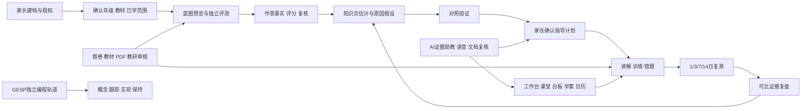

# StudyAgent 当前功能与设计总册

整理日期：2026-10-25。当前课堂实现包含[107持久插问](../product/107-classroom-turns-and-reference-state-parity.md)、[108代码实验](../product/108-classroom-code-experiments-and-draft-recovery.md)和[109图表/公式/节奏](../product/109-classroom-comparison-formulas-and-reply-pacing.md)；原件恢复见[交付106](../product/106-original-repair-product-delivery.md)。源码基线、验证与守护运行版本分别以各批收据为准，开发接入不自动等于运行交付。完整范围与剩余里程碑见[计划105](../product/105-development-plan-status-and-next-milestones.md)。

这套文档回答“当前产品有什么、各能力怎样协作、每项功能具体怎样实现”。事实以当前接入代码、共享契约和测试为准；此前九十多份交付文档作为沿革与验证证据保留。

## 阅读入口

- [功能框架](01-functional-framework.md)：14个领域、112项功能，包含角色、入口、能力和限制。
- [概要设计](02-high-level-design.md)：产品边界、角色、架构、模块依赖、业务闭环和关键设计决策。
- [核心详细设计](03-core-detailed-design.md)：范围、组题、评分、能力估计、原因验证、指导、AI、课堂和日历的处理细节。
- [数据与状态设计](04-data-and-state-design.md)：实体关系、89个领域集合、SQL结构、版本与状态机。
- [运行、资产与质量设计](05-runtime-assets-and-quality.md)：依赖、AI通道、处理链、部署、备份恢复、测试与当前证据。
- [完成边界与待完善项](06-boundaries-and-follow-ups.md)：已实现、历史保留、待验证和明确不做的范围。
- [离线功能浏览器](index.html)：按领域或关键词查找功能，展开输入、处理、输出、接口、数据与代码。

## 逐领域详细设计

1. [身份、家庭与学习权限](details/01-identity.md)
2. [知识、教材、范围与课程版本](details/02-curriculum.md)
3. [评测组题、作答与评分](details/03-assessment.md)
4. [掌握量化、原子观察与深层原因](details/04-measurement.md)
5. [指导计划、训练编排与间隔复盘](details/05-guidance.md)
6. [家庭首页、今日训练、学习记忆与错题](details/06-learning.md)
7. [题卷资产、内容编辑、导入与发布](details/07-content.md)
8. [大模型、证据助教、语音与文档模型](details/08-ai.md)
9. [学习工作台、实时课堂、白板、学案与日历](details/09-studio.md)
10. [GESP研究、C++试点与独立保持](details/10-gesp.md)
11. [主观复核、异常反馈与质量闭环](details/11-review.md)
12. [作答图片、录音与受控媒体](details/12-media.md)
13. [家庭资料下载、删除与恢复约束](details/13-privacy.md)
14. [持久化、后台处理、监控、部署与质量](details/14-operations.md)

每项功能均注明输入、处理步骤、输出、持久化集合、权限/失败/限制、接口和实际服务方法；内部算法与浏览器交互明确标识为非独立API能力。

## 开发查阅索引

- [全部接口](generated/api-reference.md)：311个源码路由声明中，当前正常接入290个、旧协议410拦截8个、未接入历史声明13个。正常接口数包含健康和运维接口。
- [页面职责](generated/page-reference.md)：26个页面和1个课堂runner处理器；部分页面是兼容重定向。
- [领域集合与260个共享类型](generated/data-reference.md)：逻辑集合不等于SQL表，Zod推导类型须继续查看源Schema。
- [功能目录JSON](feature-catalog.json)、[源码结构JSON](generated/source-inventory.json)、[接口覆盖检查](generated/coverage.json)、[整理验证收据](generated/design-validation.json)。

## 端到端产品结构



## 使用口径

“实现”指存在接入的功能与相应代码，并明确依赖和限制。它不自动表示已完成真人教学验证、全教材映射、标准化测量效度、所有设备验收或HyperKnow逐像素一致。读取进度、课堂练习、排程完成与独立测量证据分别保存。

本册仅整理设计与查阅工具，不修改运行中的业务服务、真实家庭数据、模型配置或密钥。

## 更新方法

在仓库根目录执行：

```powershell
node scripts/architecture/project-design-inventory.cjs
node scripts/architecture/build-project-design.cjs
node scripts/qa/audit-authored-curriculum.cjs data/qa/project-design-authored-audit.json
node scripts/architecture/project-content-snapshot.cjs
node scripts/architecture/validate-project-design.cjs doc/evidence/2026-10-24/material-collection-acceptance.json
npm run qa:docs
```

第一步从TypeScript AST提取实际模块依赖、路由、服务签名、集合与契约；第二步生成详细设计与离线浏览器，将人工维护的功能解释与源码交叉核对，发现缺失文件、未接入接口或未覆盖的当前API时失败。内容审计需要当前API编译产物；仅重新生成结构和功能说明时，不必重建服务。验证脚本使用已安装的Playwright Chromium，不启动API或读取家庭数据库。

功能叙述维护于 [project-feature-definitions.cjs](../../scripts/architecture/project-feature-definitions.cjs)，查阅页模板维护于 [project-design-viewer.html](../../scripts/architecture/project-design-viewer.html)。概要与核心算法文档需随业务变化人工核对，自动提取不能代替设计审查。
