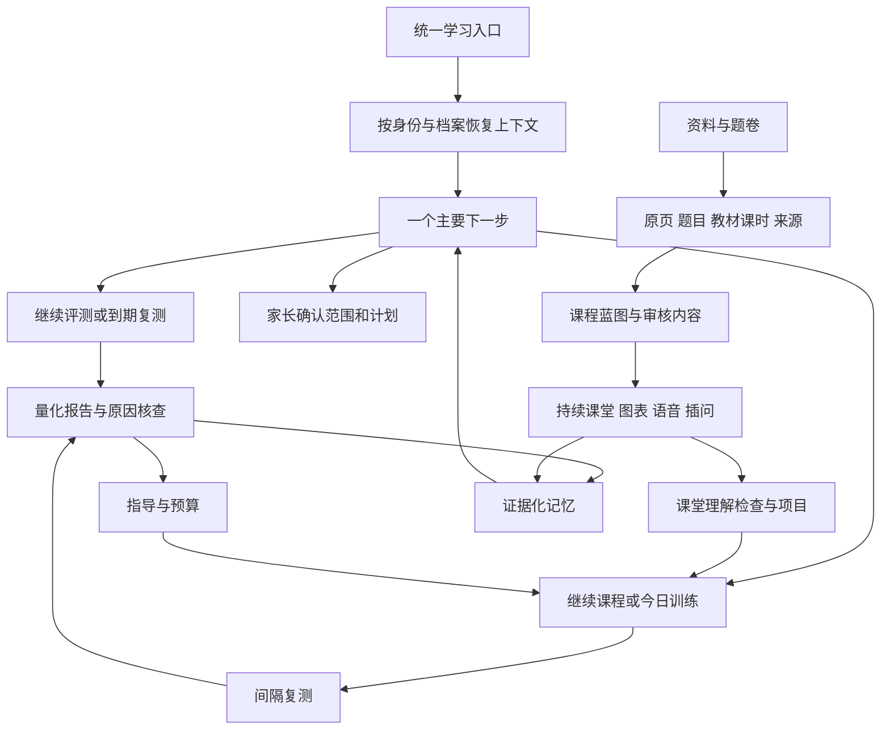

# 体验与内容完整建设总计划

日期：2026-10-23；状态核对：2026-10-24。方案基线：`fce922837f2c2907ffadd925b467f58fa2e65e0e`。对应持续目标：全面吸收已研究产品的优点，尽可能完整地还原其学习体验与内容能力；方案先归档提交，再开发，按要求逐项验收。

## 1. 目标与范围

建设一套可供家庭长期内部使用的学习产品：资料能方便整理，课程有完整结构，老师能持续讲解并响应插问，练习反馈明确，评测能定位具体知识问题，指导有依据，复测能验证效果，历史可恢复，日常操作不要求使用者理解工程结构。

对照范围包括HyperKnow的课程、课堂、练习、项目、来源与记忆体验，以及试卷宝、试卷轻量版、作业帮、小猿、快对、作业精灵、洋葱、学科网、学而思、一起作业、智慧中小学等已研究样本的资料、题目、教材、听读和纸面工作流。样本数量、产品子版本与证据范围见专项说明，不把局部样例等同于完整产品观察。

排除项沿用用户决定：付费计费、Marketplace、学校OAuth、机构租户与双向成绩回写。不排除普通教师复核、家庭ICS互通、本地部署、家庭资料管理、内容审核或备份恢复。内部使用不降低教学内容与权限准确性要求。

“最完整还原”分为五个可验收维度：

1. **画面**：参考视口、字体、色彩、布局、图表、菜单、弹窗与各状态有对应截图和差异记录。
2. **行为**：同类操作有相应触发、反馈、取消、返回、刷新恢复、错误恢复和移动端路径。
3. **教学**：目标、先修、讲解、案例、误区、图示、检查、练习、项目、单元核查、迁移与保持形成课程体系。
4. **内容**：原始资料、正文、题面、答案、媒体、教材课时映射、教学资格分别验证；缺失内容不得被生成文本冒充恢复。
5. **结果**：能证明一次学习过程保存正确，且能安排、收集和审阅后续效果证据。真人效度须用真人结果验收。

## 2. 方案文件

- [竞品优点、证据与覆盖边界](experience/01-reference-and-gap-analysis.md)。
- [角色、页面与完整交互规格](experience/02-product-and-interaction-spec.md)。
- [课程、原子知识、题库与教学内容规格](experience/03-content-and-teaching-spec.md)。
- [技术、数据、模型与资源实现方案](experience/04-technical-implementation.md)。
- [开发顺序、验收与完成审计](experience/05-delivery-and-acceptance.md)。
- [逐项需求与验收账本](experience/requirements.md)：后续实施以编号关联代码、测试和运行证据。
- [实施进度](experience/implementation-log.md)：记录实际完成范围，未验收条目继续保留。
- 连续细化规格：[运行期课堂配图](101-runtime-classroom-visuals.md)、[中英文字幕单元与旧断点](102-classroom-sentence-timeline.md)、[长资料分块与完整覆盖编排](103-long-source-course-compilation.md)、[长PDF与原件生命周期](104-long-pdf-processing-and-source-lifecycle.md)。每份规格先归档，交付证据追加到实施记录。
- [2026-10-24整体进度与后续里程碑](105-development-plan-status-and-next-milestones.md)：当前状态、版本边界、72项需求核对及M0～M7交付顺序；与原E00～E10共同使用。

本方案是现有[功能与设计总册](../design/README.md)之上的增量目标，不替换原始需求，不将现有功能重新描述为已经完成本轮目标。

## 3. 当前基础与必须解决的问题

截至2026-10-24，开发分支接入14个领域、111项功能和278个正常HTTP路由（含健康与运维），另有8个退役拦截路由；26个Web页面、86个领域集合、253个共享类型。有258个原创知识点、15758个原创任务、448条教材登记；GESP有114个候选点、3132条研究索引和49个原创试点任务。成人课程有5单元/15讲座/60微课、182道微课练习与60道单元核查、5项目15阶段。数量来自[设计快照](../design/generated/source-inventory.json)与[内容快照](../design/generated/content-snapshot.json)，只说明实现和资料基础，不表示全教材、独立题族或教学有效性。

统一首页、课程筛选/蓝图、逐句课堂/板书/插问、全微课Practice/单元新情境、项目、资料生成/编辑/复核、生图、长PDF/文件回收及双库原地续恢复均已有不同程度实现。需求账本核对后为11项implemented、46项in_progress、15项planned、0项verified；这是状态分布，不能换算完成率。部分“待实施”已有前置基础，implemented仍未满足完整验收。

主要差距：课堂全状态和参考像素差异未收敛，自适应插问与多表征不完整，课程包生命周期仍有缺口；小学教材逐课时深度和GESP完整课程不足，成人题与量规待教师逐项审核；原件修复仅完成文件协议，未接入真实任务/权限/工作台；纸面采集、选题与导出未连贯；遗留AI路径、流式聊天、记忆和日历状态需统一；设备、听感、性能、真人及真实间隔验证不足。

开发分支与运行服务分开核对：main为`7ca4b71`，最近归档守护版为`648a96d`；长PDF/回收/原地续恢复开发分支尚未切生产。本轮未重新验证运行服务。`62322b2`的[最新CI](../evidence/2026-10-24/original-repair-files-ci.json)应用、浏览器和真实PG三组通过，不能当作最新功能已经部署或完整产品完成。

## 4. 总体体验架构

统一入口只协调现有领域，不另建一份掌握度真值。小学独立测量、课堂阅读/练习、GESP编程证据仍分轨保存。完整性来源于体验连贯，不通过合并不相容的分数制造统一感。

## 5. 开发批次

- **E00 方案归档**：本文、六份规格、需求账本、实施记录先独立提交。必须在业务修改前完成。
- **E01 统一学习入口与上下文**：角色明确、恢复档案/学科、推荐下一步、待办优先级、可解释推荐、状态恢复、失败重试及旧入口衔接。
- **E02 课程与课堂完整体验**：蓝图、目录、学习/练习/资料/项目/核查统一导航；课堂分句时序、板书、插问、暂停、返回与移动触屏。
- **E03 内容深度与生成生产线**：完整课程包、课时知识拆分、题族与先修、素材多样性、成人课程题量、GESP课程和人工审核工作台。
- **E04 AI、语音、图像与表达**：统一任务生命周期、聊天流式反馈、模型能力路由、动态图表和生图、可中断语音、引用与生成内容审核。
- **E05 资料、题卷、错题与纸面**：相机/相册、裁剪旋转、多页、去笔迹、原件对照、整卷/单题、错题整理、导出打印与任务恢复。
- **E06 诊断与指导深化**：更多可观察子点、错误步骤与验证探针、预算内自适应、报告理解、教师核对、间隔复盘和效果分析。
- **E07 日历、记忆与资源连续性**：任务安排、冲突处理、手动ICS、记忆来源管理、版本缓存和长期恢复。
- **E08 产品质量与运维**：无障碍、移动录音、浏览器矩阵、性能、依赖检查、故障恢复、备份演练与可移植部署。
- **E09 内容与真人验收**：实际使用教材逐课时审核、学生与教师小样本、至少覆盖真实1/3/7/14日复测，记录误报/漏报、学习负担与使用障碍。
- **E10 全目标核对**：按需求编号审计画面、行为、内容、运行和真人证据。未知、未观察、待审核、未验证均不能标完成。

批次是依赖组织，不是范围削减。E01从当前完整主线开始提供可运行增量，后续各批次全部保留。代码/规则/自动化可以独立推进；等待真实间隔或外部审核时继续其他独立工作。

### 2026-10-24执行顺序修订

按[里程碑详细计划](105-development-plan-status-and-next-milestones.md)执行：M0原件修复真实接入及规格104最终交付 → M1完整课堂与参考全状态对照 → M2课程生命周期/题型/内容生产 → M3原子评测与原因指导深化 → M4全教材/GESP内容扩展 → M5纸面/题卷/全资产 → M6模型/记忆/日历 → M7真实设备/连续教学/最终交接。M4内容审核、M7真实试用在稳定旅程具备后滚动开展，不等待所有编码结束。

当前资料可靠性阶段以可用修复入口、取消/撤权/重启收尾、真实PDF/双库/浏览器证据与实际交付为退出条件；完成即回到课堂和教学体验。只为明确缺陷增加必要修复，不把基础设施持续扩展替代整个产品主线。未完成的E批次及72项要求全部保留。

## 6. 共同设计约束

所有正式测量结论均来自版本化作答事实。模型不能设置掌握度、补写原始答案或把未经审核知识映射变成正式发布。新内容不覆盖旧会话快照。提示、曝光、重复题、课堂完成和辅助编程均不算额外独立能力证据。

第三方体验以可观察证据逐项还原；可复用的本地资料、字体、处理工具和资产先检查实际用途、完整性、版本与许可。不能取到完整原件时，保留缺口并独立制作教学内容，不伪造第三方来源身份。此约束不限制资产大小，也不允许只复制示例后宣称全量完成。

后续每个批次需要具体页面和真实流程，不以新增接口、静态截图、字符串断言或文档“已支持”作为单独完成依据。
