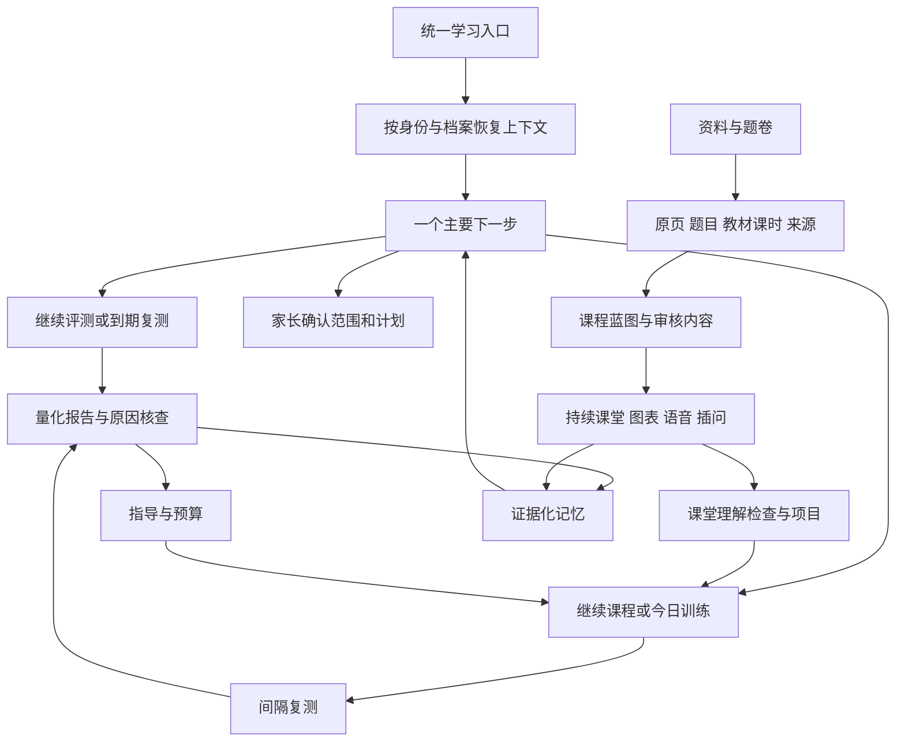

# 体验与内容完整建设总计划

日期：2026-10-23；状态核对：2026-10-25。方案基线：`fce922837f2c2907ffadd925b467f58fa2e65e0e`。对应持续目标：全面吸收已研究产品的优点，尽可能完整地还原其学习体验与内容能力；方案先归档提交，再开发，按要求逐项验收。

## 1. 目标与范围

建设一套可供家庭长期内部使用的学习产品：资料能方便整理，课程有完整结构，老师能持续讲解并响应插问，练习反馈明确，评测能定位具体知识问题，指导有依据，复测能验证效果，历史可恢复，日常操作不要求使用者理解工程结构。

对照范围包括HyperKnow的课程、课堂、练习、项目、来源与记忆体验，以及试卷宝、试卷轻量版、作业帮、小猿、快对、作业精灵、洋葱、学科网、学而思、一起作业、智慧中小学等已研究样本的资料、题目、教材、听读和纸面工作流。样本数量、产品子版本与证据范围见专项说明，不把局部样例等同于完整产品观察。

排除项沿用用户决定：付费计费、Marketplace、学校OAuth、机构租户与双向成绩回写。不排除普通教师复核、家庭ICS互通、本地部署、家庭资料管理、内容审核或备份恢复。内部使用不降低教学内容与权限准确性要求。

“最完整还原”分为五个可验收维度：

1. **画面**：参考视口、字体、色彩、布局、图表、菜单、弹窗与各状态有对应截图和差异记录。
2. **行为**：同类操作有相应触发、反馈、取消、返回、刷新恢复、错误恢复和移动端路径。
3. **教学**：目标、先修、讲解、案例、误区、图示、检查、练习、项目、单元核查、迁移与保持形成课程体系。
4. **内容**：原始资料、正文、题面、答案、媒体、教材课时映射、教学资格分别验证；缺失内容不得被生成文本冒充恢复。
5. **结果**：能证明一次学习过程保存正确，且能安排、收集和审阅后续效果证据。真人效度须用真人结果验收。

## 2. 方案文件

- [竞品优点、证据与覆盖边界](experience/01-reference-and-gap-analysis.md)。
- [角色、页面与完整交互规格](experience/02-product-and-interaction-spec.md)。
- [课程、原子知识、题库与教学内容规格](experience/03-content-and-teaching-spec.md)。
- [技术、数据、模型与资源实现方案](experience/04-technical-implementation.md)。
- [开发顺序、验收与完成审计](experience/05-delivery-and-acceptance.md)。
- [逐项需求与验收账本](experience/requirements.md)：后续实施以编号关联代码、测试和运行证据。
- [实施进度](experience/implementation-log.md)：记录实际完成范围，未验收条目继续保留。
- 连续细化规格：[运行期课堂配图](101-runtime-classroom-visuals.md)、[中英文字幕单元与旧断点](102-classroom-sentence-timeline.md)、[长资料分块与完整覆盖编排](103-long-source-course-compilation.md)、[长PDF与原件生命周期](104-long-pdf-processing-and-source-lifecycle.md)。每份规格先归档，交付证据追加到实施记录。
- [2026-10-24整体进度与后续里程碑](105-development-plan-status-and-next-milestones.md)：当前状态、版本边界、72项需求核对及M0～M7交付顺序；与原E00～E10共同使用。

本方案是现有[功能与设计总册](../design/README.md)之上的增量目标，不替换原始需求，不将现有功能重新描述为已经完成本轮目标。

## 3. 当前基础与必须解决的问题

截至2026-10-25，开发分支接入14个领域、113项功能和294个正常HTTP路由（含健康与运维），另有8个退役拦截路由；26个Web页面、89个领域集合、271个共享类型。有258个原创知识点、15758个原创任务、448条教材登记；GESP有114个候选点、3132条研究索引和49个原创试点任务。成人课程有5单元/15讲座/60微课、182道微课练习与60道单元核查、5项目15阶段。数量来自[设计快照](../design/generated/source-inventory.json)与[内容快照](../design/generated/content-snapshot.json)，只说明实现和资料基础，不表示全教材、独立题族或教学有效性。

统一首页、课程筛选/蓝图、逐句课堂/板书/插问、全微课Practice/单元新情境、项目、资料生成/编辑/复核、生图、长PDF/文件回收及双库原地续恢复均已有不同程度实现。需求账本核对后为11项implemented、46项in_progress、15项planned、0项verified；这是状态分布，不能换算完成率。部分“待实施”已有前置基础，implemented仍未满足完整验收。

主要差距：课堂全状态和参考像素差异未收敛，自适应插问与多表征不完整，课程包生命周期仍有缺口；小学教材逐课时深度和GESP完整课程不足，成人题与量规待教师逐项审核；原件修复已接入持久任务/权限/两工作台并通过双库和浏览器专项，最终CI/运行交付单独记录；纸面采集、选题与导出未连贯；遗留AI路径、流式聊天、记忆和日历状态需统一；设备、听感、性能、真人及真实间隔验证不足。

开发分支与运行服务分开核对：2026-10-24计划核对时main为`7ca4b71`、最近归档守护版`648a96d`。2026-10-25原件恢复实现`6f5e56f`及长PDF相关能力的最终CI、主线合入与守护交付，以[交付106](106-original-repair-product-delivery.md)和[最新收据](../evidence/2026-10-25/original-repair-product-acceptance.json)为准；不能把开发或CI通过直接当作已经部署或完整产品完成。

## 4. 总体体验架构

统一入口只协调现有领域，不另建一份掌握度真值。小学独立测量、课堂阅读/练习、GESP编程证据仍分轨保存。完整性来源于体验连贯，不通过合并不相容的分数制造统一感。

## 5. 开发批次

- **E00 方案归档**：本文、六份规格、需求账本、实施记录先独立提交。必须在业务修改前完成。
- **E01 统一学习入口与上下文**：角色明确、恢复档案/学科、推荐下一步、待办优先级、可解释推荐、状态恢复、失败重试及旧入口衔接。
- **E02 课程与课堂完整体验**：蓝图、目录、学习/练习/资料/项目/核查统一导航；课堂分句时序、板书、插问、暂停、返回与移动触屏。
- **E03 内容深度与生成生产线**：完整课程包、课时知识拆分、题族与先修、素材多样性、成人课程题量、GESP课程和人工审核工作台。
- **E04 AI、语音、图像与表达**：统一任务生命周期、聊天流式反馈、模型能力路由、动态图表和生图、可中断语音、引用与生成内容审核。
- **E05 资料、题卷、错题与纸面**：相机/相册、裁剪旋转、多页、去笔迹、原件对照、整卷/单题、错题整理、导出打印与任务恢复。
- **E06 诊断与指导深化**：更多可观察子点、错误步骤与验证探针、预算内自适应、报告理解、教师核对、间隔复盘和效果分析。
- **E07 日历、记忆与资源连续性**：任务安排、冲突处理、手动ICS、记忆来源管理、版本缓存和长期恢复。
- **E08 产品质量与运维**：无障碍、移动录音、浏览器矩阵、性能、依赖检查、故障恢复、备份演练与可移植部署。
- **E09 内容与真人验收**：实际使用教材逐课时审核、学生与教师小样本、至少覆盖真实1/3/7/14日复测，记录误报/漏报、学习负担与使用障碍。
- **E10 全目标核对**：按需求编号审计画面、行为、内容、运行和真人证据。未知、未观察、待审核、未验证均不能标完成。

批次是依赖组织，不是范围削减。E01从当前完整主线开始提供可运行增量，后续各批次全部保留。代码/规则/自动化可以独立推进；等待真实间隔或外部审核时继续其他独立工作。

### 2026-10-24执行顺序修订

按[里程碑详细计划](105-development-plan-status-and-next-milestones.md)执行：M0原件修复真实接入及规格104最终交付 → M1完整课堂与参考全状态对照 → M2课程生命周期/题型/内容生产 → M3原子评测与原因指导深化 → M4全教材/GESP内容扩展 → M5纸面/题卷/全资产 → M6模型/记忆/日历 → M7真实设备/连续教学/最终交接。M4内容审核、M7真实试用在稳定旅程具备后滚动开展，不等待所有编码结束。

当前资料可靠性阶段以可用修复入口、取消/撤权/重启收尾、真实PDF/双库/浏览器证据与实际交付为退出条件；完成即回到课堂和教学体验。只为明确缺陷增加必要修复，不把基础设施持续扩展替代整个产品主线。未完成的E批次及72项要求全部保留。

## 6. 共同设计约束

所有正式测量结论均来自版本化作答事实。模型不能设置掌握度、补写原始答案或把未经审核知识映射变成正式发布。新内容不覆盖旧会话快照。提示、曝光、重复题、课堂完成和辅助编程均不算额外独立能力证据。

第三方体验以可观察证据逐项还原；可复用的本地资料、字体、处理工具和资产先检查实际用途、完整性、版本与许可。不能取到完整原件时，保留缺口并独立制作教学内容，不伪造第三方来源身份。此约束不限制资产大小，也不允许只复制示例后宣称全量完成。

后续每个批次需要具体页面和真实流程，不以新增接口、静态截图、字符串断言或文档“已支持”作为单独完成依据。

2026-10-25进展：M0原件恢复已完成三组CI、主线推送和本机守护交付，证据见[交付106](106-original-repair-product-delivery.md)。M1已按先归档的[规格107](107-classroom-turns-and-reference-state-parity.md)接入持久插问、五种讲法和原句恢复；当前完整API回归1061通过/34环境跳过，PG课堂组合26通过/1SQLite专属跳过，真实默认模型合成案例一次通过，最终浏览器与远端/运行门禁另记。下一增量[代码实验108](108-classroom-code-experiments-and-draft-recovery.md)已在编码前提交。72项状态保持原范围，未宣称全产品完成。

2026-10-25课堂后续：持久插问`1dec77f`已完成远端应用/浏览器/PG三组CI和本机守护交付；代码实验`2c3922c`已实现按块代码/输入草稿、离线/冲突恢复、受控输入执行和个人导出，本地完整API1069/34环境跳过、PG33/2SQLite专属跳过、浏览器组合21及最终定向4通过（不相加）。见[108与本地收据](108-classroom-code-experiments-and-draft-recovery.md)，远端及运行交付另记。完整M1/M2和72项仍按各自全部验收推进。

2026-10-25后续：108代码实验已完成CI/守护交付；109对照表、公式和插问按句呈现已进入最终回归，见[规格109](109-classroom-comparison-formulas-and-reply-pacing.md)。设计共享类型增至265，业务路由/集合未新增。真实默认模型只完成合成平均分一例校验；完整M1～M7及72项要求保持原范围。

109最终交付：归档提交`8380713`的CI 40161620393三组成功，应用1079通过/42环境跳过、浏览器73通过、PG插问16/1 SQLite专属跳过、字幕11、代码草稿7/1 SQLite专属跳过。主线实际生产构建并运行`8380713`（业务`89e7530`）；一致数据库/引用运行文件和旧构建已备份，五处原配置保留，八项匿名烟测和间隔至少60秒的PID/重启观察通过。见[运行收据](../evidence/2026-10-25/classroom-board-runtime.json)与[最终验收](../evidence/2026-10-25/classroom-board-acceptance.json)。110课程版本规格已先提交，业务仍在独立工作区开发，未混入本次运行。完整M1/M2和72项需求仍按原验收范围推进。

2026-10-25版本管理续进：110实现aef3bc8与本地最终验证已归档，资料课程可创建修订、预览影响、原子发布与归档替代、撤回/恢复并恢复原课堂；私有修订与阶段来历受读取/导出/删除保护。完整API1098/34环境跳过，PG44/1 SQLite专属跳过，新旧资料课浏览器15与最后定向6通过（不相加）。CI与运行交付待最终收据，72项完整范围保持。

111项目附件最终交付：精确CI6b27001/40169523078三组成功，应用1101通过/43环境跳过、浏览器83通过/0重试、PG附件11通过/1个SQLite专属跳过。本地83项完整浏览器亦全部通过。主目录以6b27001生产构建（业务a03aa56），11项匿名烟测及三次超过60秒的稳定观察通过；原五处配置、一致数据库/全部引用运行文件与旧构建回退保留。见[最终验收](../evidence/2026-10-25/project-files-acceptance.json)与[运行收据](../evidence/2026-10-25/project-files-runtime.json)。首次Linux原生协议与浏览器注册桶失败保留；Office内容渲染、完整多模态AI、真实设备/教师及M1～M7其余门禁继续保留。112可恢复草稿/17题型旅程规格已提前归档，接续实施；72项仍11 implemented/46 in_progress/15 planned/0 verified。

2026-10-25：112可恢复作答实现0683a85已提交：诊断与训练共用版本化保存控制，完整本地稿/原提交命令、两标签冲突比较/下载、原耗时回执、明确订正次数与账号/冻结题目绑定；提交后内部日志从助教草稿及家庭可移植草稿中剔除。17题型×两条正式路径与恢复专项已形成合成浏览器证据；最终127项完整回归、精确远端CI与守护发布待终态。双库最终投影分别22与10通过/1个SQLite专属跳过；此前完整API1119通过/36环境跳过，范围重叠不相加。设计当前14领域/114功能/306正常路由/91集合/285共享类型、125 API测试文件/21浏览器文件。教师、实机、参考全状态、全教材与M1～M7其余门禁保持，72项状态未提升。见[本批收据](../evidence/2026-10-25/answer-draft-acceptance.json)。

2026-10-25最终交付记录：112可恢复作答已完成精确CI b30f857/40175127418三组验证：应用1111通过/44环境跳过，浏览器127通过/0重试；PG草稿与原生恢复10通过/1个SQLite专属跳过。本地完整127浏览器亦全部通过。主目录已以b30f857实际生产构建（业务0683a85），当前Web buildId为Q7VTRVb_DBPNDIRjrk9ow，13项匿名烟测通过；三次PID/重启观察跨77928毫秒且无变化；原五处配置、一致数据库/引用运行文件与旧构建回退保留，见运行收据。17类题型在诊断和训练的完整输入、刷新、首答及历史读取已有自动化证据，真实触屏/录音/读屏/教师与M1～M7其余门禁保留。113助教持久提问/取消/历史规格已先以115c119归档，业务尚未实施。72项完整需求继续11 implemented/46 in_progress/15 planned/0 verified。见[本批验收](../evidence/2026-10-25/answer-draft-acceptance.json)。

2026-10-25：114课堂工具实现0dd1d04已完成本地验证：34项课堂/图表/字幕/代码/插问/生成图组合通过，最终遮挡与字号微调后5项专项通过，范围重叠不相加。七步真实控件导览、暂停与布局/焦点恢复、全屏SVG/课件图片阅读、460px设置和独立已展示当前句试听已接入；首轮测试定位失败和视觉发现的弹层裁切保留，真实音色听感及100%CSS/字体未验。设计保持14领域/114功能/306正常路由/91集合/285共享类型，浏览器文件22；2477文档链接与10项离线设计检查通过。精确远端CI和主目录守护交付尚待；当前运行仍是112的b30f857。113助教持久任务、115课堂多选均只有已提交规格，M1～M7完整目标和72项状态保持，见[114验收收据](../evidence/2026-10-25/classroom-tools-acceptance.json)。

114最终工具交付：业务0dd1d04，精确CI 8b033ed/40180127851三组成功，应用1111通过/44环境跳过、浏览器132通过/0重试，PG最后草稿组10通过/1个SQLite专属跳过；本地完整132项也全部通过。主目录以8b033ed完成真实生产构建（buildId 3dd7PUBtRFNYTVkGO9yZZ），15项匿名烟测和三次跨68029毫秒的稳定观察通过；原五处配置字节、发布前一致数据库/引用文件与旧构建回退保留。详见[最终验收](../evidence/2026-10-25/classroom-tools-acceptance.json)与[运行收据](../evidence/2026-10-25/classroom-tools-runtime.json)。设置、锚点导览、独立当前句试听与全屏图形阅读已可使用。原站六声线与当前各供应商五项目录、课前样本、实际听感、原DPR/字体/CSS和完整自由白板等仍有差异；113助教持久任务和115课堂多选仅完成规格，尚未业务实现。完整M1～M7与72项需求的教师、实机、全内容和长期门禁保持，整体目标继续，不据CI提升整体完成度。

2026-10-27原卷练习127已正式交付：精确CI头5468948/40368316059三组success，298浏览器原始单次通过、零失败/跳过/flaky/重试；Linux完整API1331通过/62环境跳过。本地未变运行代码基线为1339 API通过/54环境跳过及298浏览器通过，后续仅测试/工作流修正另有专项复验，不声称修正后又重跑全部本地。主目录实际构建buildId KSryKnPctKjE4SgQbXojy、schema18，178项HTTP/鉴权/资源、27编译及6原音频SHA通过，三次守护观察跨77565毫秒且PID/重启计数保持。五处配置与真实环境原字节保留；发布前新鲜126/schema17停服一致数据库及引用运行文件、900旧编译和私有配置回退已核对，assetsIncluded:false，不是全部研究资产或完整恢复演练。入口为题卷库的整卷/选题/跨卷练习与历史；首答、原参考、自评、订正、暂停/完成和连续刷新恢复分别留证。XP-H03改为in_progress，72项11 implemented/49 in_progress/12 planned/0 verified。128仍在隔离开发；M1～M7、全内容、原CSS/字体/DPR/原声、教师/实机/长期目标继续active。见[127验收](../evidence/2026-10-27/paper-practice-acceptance.json)、[精确CI](../evidence/2026-10-27/paper-practice-exact-ci/receipt.json)、[运行](../evidence/2026-10-27/paper-practice-runtime.json)。

2026-10-27原卷复习128正式交付：Web业务60263b3、API0988208、精确CI fd519aa/40382195553三组success，315浏览器原始单次通过、零失败/跳过/flaky/重试；Linux完整API1346通过/62环境跳过。本地完整API1354通过/54环境跳过，完整浏览器315原始单次通过，PG及双库原生恢复23通过，范围不相加。主目录实际构建buildId h8w5_Im73EsyxJOu3c20J、schema18；200项HTTP/鉴权/资源、32编译及6原音频SHA通过，三次守护观察跨99203毫秒PID/重启计数保持。五处配置和真实环境原字节保留；新鲜127/schema18停服一致数据库及引用运行文件、917旧编译及私有配置回退核验，assetsIncluded:false，不是完整研究资产备份或生产恢复演练。复习工作区、完整整理历史、原题再练、审核知识点下正式独立新题、原卷曝光隔离及本人/孩子日历和ICS可用。XP-H06因复习回流接通由planned改为in_progress，异步导出中心仍待；72项为11 implemented/50 in_progress/11 planned/0 verified。129原始字体/样式及教学外壳继续隔离开发，未混入本次正式构建；M1～M7、全部内容/原CSS字体DPR原声/教师实机长期目标仍active。见[128验收](../evidence/2026-10-27/paper-review-acceptance.json)、[精确CI](../evidence/2026-10-27/paper-review-exact-ci/receipt.json)、[实际运行](../evidence/2026-10-27/paper-review-runtime.json)。

2026-10-27原字体与累积白板129正式交付：固定业务a1adbd9、精确CI a8d3578/40402400667三组success；本地和精确远端322浏览器均原始单次通过，零失败/跳过/flaky/重试，Linux完整API重新运行1346通过/62环境跳过。本地API1354通过/54环境跳过和PG/双库恢复23通过明确继承128收据，本批未重跑；API/契约/依赖/工作流源码相同，335编译JS中334逐字节相同、一份仅CRLF差异，原与LF摘要均保留。主目录实际生产构建buildId hB-kjsY_yDoLds_3N-vY5、schema18；1160项实际HTTP、335编译、958原资产/字体/MathLive静态字节及6音频SHA通过，三次守护观察跨185765毫秒PID/重启计数稳定。五处本地配置与真实环境原字节保留，新鲜128/schema18停服一致数据库/引用文件及942旧编译/私有配置回退已核验，assetsIncluded:false，不是全研究资产备份或完整恢复演练。真实本机Xiaolai/Virgil/Satoshi/MiSans、白色点阵、原作用域CSS、累积已讲知识块/整行表格和当前完整句字幕已上线；原公式向量与真实视频布局/音轨/SRT继续。130六档速度/原设置/导览/可调面板/菜单保持独立，未混入本次生产；原手工几何、插问、全部课程/练习/项目外壳和参考状态/DPR/原声/教师实机长期等M1～M7仍待，整体目标active。72项口径保持11 implemented/50 in_progress/11 planned/0 verified。见[129本批验收](../evidence/2026-10-27/teaching-frame-acceptance.json)、[精确CI](../evidence/2026-10-27/teaching-frame-exact-ci/receipt.json)和[实际运行](../evidence/2026-10-27/teaching-frame-runtime.json)。
