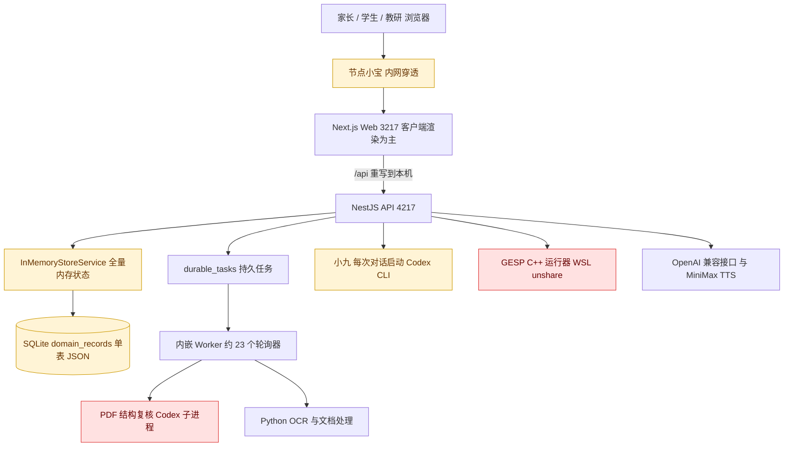
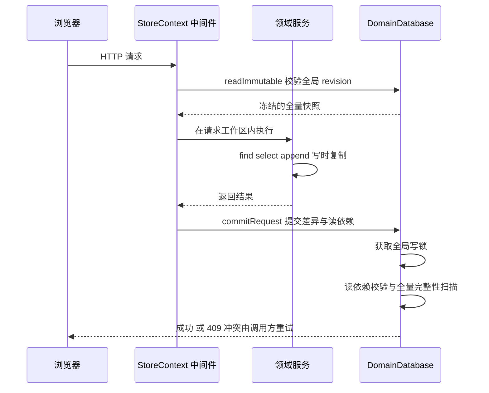
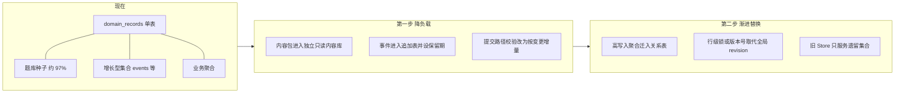
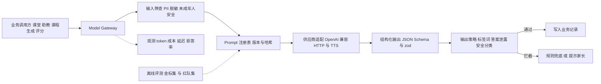
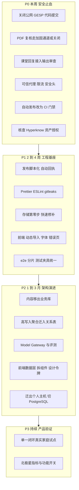

# StudyAgent 技术方案与实现评审（2026-11-05）

本文是一次只读评审：没有修改任何源码、配置或数据，没有提交或推送，也没有对线上环境做渗透验证。结论基于 2026-11-05 主目录 `main`（最近提交 `56caddec`）的源码、CI 配置、`.cursor/rules`、`doc/` 下的设计与发布记录，以及本机正式库的只读统计。凡是根据代码推断、未实际运行验证的，文中标注为“推断”。

## 1. 一页结论

StudyAgent 在“证据化、可恢复、权限断言、首败留存”这些工程纪律上投入极深，很多单点实现（会话与授权、持久任务队列、备份恢复守卫、上传与路径防护）质量很高。但整体呈现三个叠加的结构性风险：**公网暴露面上有两条可直达宿主机与密钥的高危路径**；**自研的“全量内存文档库”存储层把内容、业务和完整性校验压在一把全局写锁上，形成增长天花板**；**由 AI 代理直接在单主干上开发并自动发布到生产，缺少 CI 门禁和人工审查**。在此之上，产品范围远超当前真实使用规模，文档与证据体量已开始反噬可维护性。

| # | 结论 | 严重度 | 一句话建议 |
|---|---|---|---|
| 1 | GESP C++ 运行器的命名空间沙箱可被学生代码逃逸，能触达正式库、`.env` 和整个开发目录（推断，未做 PoC） | 严重 | 公网立即关闭代码提交，换 nsjail/bubblewrap/容器并迁到独立主机 |
| 2 | PDF 结构复核以仓库根为工作目录、继承全部环境变量启动 Codex 代理，且默认开启；上传 PDF 可做提示注入 | 高 | 改走已加固的小九通道，或公网默认关闭 |
| 3 | 面向孩子的课堂 AI 回复未经任何输出审查；安全策略只是标签词正则 | 高 | 建统一的输入/输出安全管线，所有儿童可见输出必经 |
| 4 | 存储层每次写入都在全局写锁内做全量完整性扫描，状态常驻内存约三份，约 97% 是题库种子内容 | 高（潜在） | 先把内容移出业务库、把校验改增量，再渐进式“绞杀”到关系表 |
| 5 | AI 代理自动提交、推送并发布到生产，发布条件不含 CI 结果，且 schema 升级不可直接回滚 | 高 | 改为“CI 全绿 + schema 变更人工批准 + 脚本化发布” |
| 6 | 范围很宽（三科诊断、化学、GESP、成人课程、AI 课程生成、白板/TTS、试卷库/OCR），正式库全局 revision 仅约 203，说明真实写入极少 | 中（战略） | 选一个核心闭环做真实家庭试点，其余模块默认关闭 |

需要注意的是，第 4 条目前不是线上瓶颈：正式库真实写入很少，性能问题是“随增长必然出现的天花板”和“开发时的认知负担”，而不是今天的故障。因此建议的是渐进式演进，不是推倒重写。

## 2. 现状速览

| 维度 | 数据 |
|---|---|
| 开发周期 | 2026-04-20 至今，927 次提交，单主干 `main` |
| 技术栈 | Next.js 16.4 + React 19；NestJS 11 API + Worker；Node 24；SQLite（正式）/ PostgreSQL（可选）；Python OCR/文档处理；WSL C++ 运行器 |
| 代码体量 | API 非测试 TS 约 5.4 MB，API 测试约 4.4 MB；Web TS/TSX 约 3.1 MB（298 个文件）；contracts 约 0.33 MB；scripts 约 2.8 万行；e2e 70 个 spec |
| 存储 | 单表 `domain_records`，142 个“集合”，schema 版本 38（37 次 `migrateConstraints`） |
| 正式库 | 本机 `data/study-agent.sqlite3`（约 70 MB），约 8.99 万条记录；其中 5 个题目类集合约 33 MB，占 JSON 体量约 97% |
| 部署 | 个人 Windows 主机，PM2 守护 API:4217 / Web:3217，经“节点小宝”映射到 `study-agent.iepose.cn`，开放注册 |
| 文档 | `doc/` 下 388 个 Markdown；`doc/product` 下编号文档到 231；`doc/evidence` 约 1.4 万个文件；`.git` 约 1.2 GB |
| CI | 三个作业（application 60 分钟、browser 60 分钟、postgres 45 分钟上限）；浏览器 466 条旅程约 42 分钟，单 worker |

当前运行拓扑与风险热点如下（红色为严重/高危，黄色为结构性风险）。

## 3. 安全与合规（最优先）

### 3.1 发现

| ID | 严重度 | 问题 | 证据 | 建议 |
|---|---|---|---|---|
| S1 | 严重 | GESP 沙箱可逃逸 | `scripts/gesp/run_submission.cjs:43-58` 用 `unshare --user --map-root-user --mount --pid --net` 启动，只用 tmpfs 覆盖 `/mnt`、`/home`、`/root`、`/tmp`。学生程序在该用户命名空间内是 root 且持有 CAP_SYS_ADMIN，这些 tmpfs 是本命名空间自己挂的、未被锁定，`umount /mnt` 即可露出 WSL 下的 `/mnt/f/...`。没有 seccomp、没有 capability 收缩、没有 pivot_root。正式库就在 `F:\workspace\github\StudyAgent\data\` 下，`.env` 也在同一目录。`gesp.service.ts:539` 启动 runner 时未传 `env`，会继承 API 全部环境变量。任何公网注册的家长都能“建孩子 → 学习码 → 学生身份 → 提交代码”（`auth.guard.ts:90`）。 | 公网立即用开关关闭代码提交；改用 nsjail/bubblewrap，或 `--network none --read-only --cap-drop ALL` 的容器加 seccomp 和 cgroup 限制；`env: {}`；放到与业务数据隔离的主机或 VM；补一条 `umount` 逃逸回归测试 |
| S2 | 高 | PDF 复核代理可读仓库与密钥 | `apps/api/src/modules/ai/codex-pdf-structure.service.ts:88-91` 使用 `-C process.cwd()`（仓库根），`:125-126` 使用 `env: process.env`，未关闭 Codex 的 shell 等工具。输入是用户上传的 PDF 页面图像和文本。`processing-worker.service.ts:112` 只有显式设为 `false` 才关闭，正式 `.env` 未设置，即默认开启。推断：PDF 内的提示注入可让代理读取 `.env` 并把内容写进抽取结果回显给上传者。 | 复用 `xiaojiu-chat.service.ts` 已有的加固（空临时目录、强制 `tools=[]` 的本地代理、环境白名单、关闭全部功能），或公网环境默认关闭 |
| S3 | 高 | 儿童可见的课堂 AI 回复无审查 | `apps/api/src/modules/learning/classroom-turn-worker.service.ts:58-72` 直接把 `response.reply` 写入会话。`inspectTeachingOutput` 只在 `ai.service.ts` 三处调用，内容是“笨、ADHD、确诊”一类标签词正则（`teaching-output-policy.ts`），不覆盖色情、暴力、自伤，儿童输入也不做筛查。 | 统一输入/输出安全管线：输入筛查、结构化校验、标签词与答案泄露检查、内容安全分类；被拦截时回落规则指导，必要时提示家长 |
| S4 | 中 | 旧评分路径信任宽松解析的模型输出 | `assessments.service.ts:263`、`missions.service.ts:259-260` 用 `Boolean(ai.structuredResult.correct ?? false)`，字符串 `"false"` 会被判为正确；学生作答原文进入提示词，可被注入。 | 严格 zod 布尔 schema；能确定性评分的不交给模型；不确定的进入人工复核 |
| S5 | 中 | 限流在代理后退化为全站一个桶 | `apps/web/next.config.ts` 把 `/api` 重写到 `127.0.0.1`；`infrastructure/trusted-proxy.ts:4` 未配置时返回 `false`；正式 `.env` 未设置 `STUDY_TRUST_PROXY`。所有请求的来源 IP 都是 127.0.0.1，注册限额（`auth.service.ts:20,24`，15 分钟 30 次）全站共享；按账号的登录锁定可被用来锁住已知家长。 | 配置可信代理，并核实穿透工具是否透传真实客户端 IP；注册加人机验证，登录改指数退避 |
| S6 | 中 | 缺少安全响应头 | Web 没有 `headers()`；API 没有 helmet，只设置了 nosniff、referrer 和 no-store（`request-context.middleware.ts:25-27`）。 | 加基于 nonce 的 CSP、`frame-ancestors 'none'`、HSTS、Permissions-Policy，关闭 `poweredByHeader` |
| S7 | 中 | 子进程缺统一并发与进程树管理 | 每次小九对话都启动一个 CLI 进程（`xiaojiu-chat.service.ts:186-189`）；PDF 超时只调用 `child.kill()`（`codex-pdf-structure.service.ts:131`）；Windows 下回退到 `shell: true`（`codex-command.ts:31`）；GESP 运行没有并发上限。 | 按资源设全局信号量或队列；统一使用已有的 `terminateChildProcess`；禁止 shell 回退；按家庭设每日额度 |
| S8 | 低 | 生产接受默认密钥 | `packages/config/src/index.ts:30` 默认 `study-agent-dev-secret`。实际只用作日历订阅地址的 AES 密钥（`studio-integration.service.ts:28`），正式 `.env` 已自定义。 | 生产启动时拒绝默认值；改名为加密专用密钥并用 HKDF 派生 |

### 3.2 托管与合规

正式环境运行在开发用的 Windows 主机上，正式库、`.env`、源码和 QA 数据都在同一个工作目录里。这会把 S1、S2 的后果从“沙箱失守”放大为“生产数据、密钥和开发环境一次性暴露”。建议把生产迁到独立的 Linux 云主机或容器（应用、数据库、GESP 运行器分开），开发机只做开发。

儿童数据外发方面：孩子的自由文本（最多 3000 字，`ai.service.ts:577`）、作答、草稿和上传的 PDF 页面图像会发给 DeepSeek/OpenAI 兼容接口，课程检索会访问搜狗。目前没有按供应商区分的监护人同意开关，没有脱敏，`assistantMessages`、`aiInsights` 也没有保留期。按《个人信息保护法》，不满十四周岁未成年人的个人信息属于敏感个人信息，处理需取得监护人同意并有更严格的要求。这里只是提示风险，不构成法律意见，建议上线前咨询专业人士。

第三方资产方面：`apps/web/public/reference/hyperknow` 下有 944 个受 Git 跟踪的文件（约 40 MB 字体与 CSS），`app/layout.tsx` 在每个页面都加载其中的 Satoshi 和 MiSans 字体样式；`app/studio/original-teaching-shell.generated.css` 等四个文件共约 117 KB，文件头写明是“Captured original teaching styles”。从竞品产品镜像资产并在公网分发存在授权风险，需要逐项核实字体和样式的许可，必要时替换为自有或明确开源授权的资源。

## 4. 存储与运行时架构

### 4.1 现状设计

所有业务数据以 JSON 文档存进同一张表 `domain_records(collection, record_id, body, position)`，配一行全局 `store_meta.revision`。每个进程把全部数据加载为冻结的内存快照；每个请求在 AsyncLocalStorage 工作区里写时复制，结束后计算差异，在全局写锁内校验读依赖和完整性后提交。

这套设计的初衷可以理解：用一个兼容旧内存 Store 的接口，换来事务性、可恢复和“原记录逐字节保持”的验证能力。持久任务队列（`durable_tasks`，PostgreSQL 下 `FOR UPDATE SKIP LOCKED`，租约 fence 与领域写入同一事务）设计正确，应当保留。

### 4.2 问题

| ID | 问题 | 证据 | 影响 |
|---|---|---|---|
| D1 | 全局写锁内的全量完整性扫描 | `modules/diagnostics/textbook-teaching-native.ts:17-46`：只要 `diagnosticSessions`、`students`、`studioCourses` 等有任何改动，就读取整组相关集合并逐会话校验，循环内还有 `users.some`。`modules/library/paper-export-persistence.ts:5-8,27-33` 最多读取 1,000,001 行。两者都在 `domain-database.ts:481-482,511-512` 的 `BEGIN IMMEDIATE` 或 `FOR UPDATE` 内执行。 | 写延迟随全库规模线性增长，所有写入串行等待 |
| D2 | 全量状态常驻内存，约三份 | `in-memory-store.service.ts:305-327` 启动时先 `read()` 克隆，再克隆到 `root`，引导后再克隆到 `baseline`，两者都不释放；`domain-database.ts:390-404` 每次提交重建整个受影响集合的数组 | 内存约为数据量的三倍；冷启动全量加载；每次写都按集合大小付费 |
| D3 | 内容种子与业务数据混存 | 正式库约 97% 是题目类种子；`foundation-seed.service.ts` 每次启动补种；题目 ID 由内容哈希生成，修改题目会产生新行而旧行保留 | 内容规模直接决定内存、启动和克隆成本；代码与库内容按设计持续漂移 |
| D4 | 单进程串行队列加单行全局 revision | `domain-database.ts:374,450,494`；`task-repository.ts:301-303` | 写入无法水平扩展；一个慢校验会阻塞所有请求的开始 |
| D5 | 非测试源码 174 处直接集合属性访问（连同测试约 435 处；初稿误把含测试的数字当作源码数字，已更正） | 属性 getter 会深克隆整个集合并登记“整集合读依赖”（`in-memory-store.service.ts:217-236,244-250`），例如 `question-coverage.service.ts:152-221` 一次克隆约 1.78 万行 | 单请求克隆数 MB；其他请求的任意写入都会让本请求 409 |
| D6 | 长耗时 AI 调用在隐式请求工作区里 | `assessments.service.ts:84-85` 先等模型评分，再整集合读取 `assessmentAnswers` | 模型延迟期间他人写入即导致冲突，AI 结果被丢弃；默认路径没有通用重试 |
| D7 | 上下文外静默读写启动时数据 | `in-memory-store.service.ts:246,262,280,301` 在没有工作区时回退到 `this.root` | 漏写 `transaction()` 时读到旧数据，写入不会持久化，而且没有任何报错 |
| D8 | 无界增长集合 | `events` 只有一处追加（`domain-event-bus.service.ts:19`，71 处发布）且从不删除；`diagnosticResponses`、`assistantMessages`、`durable_task_history` 等同理 | 规模上升后会放大 D1、D2 |
| D9 | 模块边界失效 | `in-memory-store.service.ts` 有 47 个领域类型导入，`domain-database.ts` 直接导入 12 个领域完整性模块；`CoreModule` 为 `@Global`；`users` 集合被 9 个模块的 70 个文件读取 | 改动影响面难以评估，基础设施随业务膨胀 |
| D10 | 模式演进靠宽容读取器和手工阶梯 | `readSnapshot` 只做 `JSON.parse`，持久化边界没有 schema 校验；8 组 `schemaNN-reader` 测试加 `resources/compatibility/` 下约 22 MB 旧构建；`doc/product/05-running-and-storage.md:25` 仍写“当前版本8”；发布记录承认“旧37读取器不能直接打开38” | 回滚困难，文档与实现漂移 |

### 4.3 建议：先降负载，再渐进替换

不建议重写。这套存储已经承载了大量恢复、隐私删除和兼容逻辑，重写的风险和成本都高。更务实的做法是三步走，每一步都能单独交付并带来收益。

**第零步（低风险，1 至 2 周）：** 持久模式下在请求上下文之外访问 Store 直接抛错（D7）；启动完成后释放 `root` 和 `baseline`；用 ESLint `no-restricted-syntax` 禁止新增 `store.<collection>` 直接访问，再逐模块替换为 `select`/`find`（D5）；为 `DomainWriteConflict` 提供通用的有界重试，借助已有的 `requestKey` 保证幂等；把旧评分路径改成“事务 → 外部调用 → 复验事务”的模式（D6），新代码里已有这种写法（`assistant-turn-worker.service.ts:24-42`）。

**第一步（降负载，2 至 4 周）：** 题库和课程内容不再写入 `domain_records`，改为版本化内容包（JSON 加 manifest 加哈希）导入独立的只读内容库，请求工作区不再加载它们；项目里已经有“题卷与 GESP 只读索引”的先例可以复用。仅这一项就能让常驻内存和冷启动成本下降约一个数量级。`events` 和 `durable_task_history` 改为追加表并设保留期或归档。提交路径上的完整性检查改为只校验本次变更涉及的聚合，全量巡检改成离线定时任务加告警。

**第二步（渐进替换，1 至 3 个月）：** 为写入最频繁的聚合（诊断会话与作答、助教消息、课堂会话）建立真正的关系表，通过 Repository 接口访问，用 Kysely 或 Drizzle 获得类型安全的 SQL；用聚合级行锁或乐观版本号取代全局 revision；生产切换到 PostgreSQL（CI 已有 Postgres 作业）；在持久化边界用 zod 校验；数据迁移改为显式的 upcaster；restore guard 的版本阶梯从单一来源生成，不再在 `domain-database.ts` 和 `scripts/operations/database-reader-guard.cjs` 两处手工同步。

## 5. AI 方案

### 5.1 现状

模型调用分散在四条路径上：OpenAI SDK 直连（`ai.service.ts:66-73`，12 秒超时，不重试），用于评分、提示、导入结构化和计划补充；“小九”每次对话启动一个 `codex exec` 子进程（`xiaojiu-chat.service.ts:109-127`），这一路加固得不错，有空目录、`--sandbox read-only`、强制 `tools=[]` 的本地代理、环境白名单、JSON Schema 加 zod 校验和一次带错误反馈的重试，已被 15 个服务通过 `structured()` 复用；PDF 结构复核是另一条未加固的 Codex 路径；课堂配图还有一条 Python 技能路径。

### 5.2 问题

第一，把 Codex CLI 当生产推理运行时。每个请求一个进程，供应商与认证来自运营者本机的 `CODEX_HOME` 配置（推断依赖个人登录），本地代理会缓冲完整响应，无法流式输出，并发和成本都不可控。DeepSeek 等供应商本身就提供 OpenAI 兼容的 HTTP 接口和 JSON 输出，没有必要绕道 CLI。

第二，没有评测。集成测试 mock 了供应商（例如 `teaching-tool.integration.test.ts:32`），e2e 拦截了 AI 路由；`scripts/qa/source-course-live.cjs` 是单次真实样例，回执自述不是可靠性研究；`qualify-xiaojiu-models.cjs` 只验证通路（让模型算 17+25）。对“提示不泄露答案、指导不贴标签、课程忠于来源、白板 LaTeX 合法”这些核心质量要求，没有可回归的度量。

第三，提示词以内联中文字符串散落在代码里，只有零散的 `promptVersion` 标签；没有 token 与成本记账（代码里没有读取 `usage`），没有缓存；安全策略覆盖不全（见 S3）。`renderAssistant` 中的 `'openai'` 分支看起来不可达（推断），属于待清理的死代码。

### 5.3 目标架构

具体做法如下。用一个 `ModelGateway` 收拢全部调用，以 OpenAI 兼容 HTTP 接口加严格 `json_schema` 取代每请求启动 CLI，把小九现有的 schema 校验与重试逻辑迁进网关。提示词放进版本化文件，每次输出记录提示词 ID、哈希、模型和策略版本。每个儿童可见的场景都过同一条策略管线。观测方面可以自托管 Langfuse，或按 OpenTelemetry GenAI 约定上报，记录 token、成本、延迟和拦截率，并设置按家庭与全局的预算。评测方面为每个场景建金标集，另建一套面向未成年人的红队集（自伤、色情、诱导索取个人信息、PDF 提示注入），用规则加 LLM 评审打分，夜间对固定模型版本运行并设阈值，人工审核只做抽样。确定性的生成结果按输入哈希缓存。

## 6. 前端

| ID | 问题 | 证据 | 建议 |
|---|---|---|---|
| F1 | 几乎全部客户端渲染，没有数据层 | 298 个 TS/TSX 中 204 个是 `'use client'`；`apiRequest` 在 125 个文件中调用 570 次，均在 `useEffect` 里；16 个文件各自请求 `/learning/students`，`type Child` 在三处重复定义 | 引入 TanStack Query 或 SWR，封装 `apiRequest(path, schema)` 并用契约 zod 校验响应；上传也走同一封装，去掉 13 处手写 `fetch` |
| F2 | 巨型组件 | `app/admin/content/page.tsx` 2,967 行、50 个 `useState`、402 处内联 style；`studio/classroom/workbench.tsx` 中 `ClassroomSession` 有 42 个 `useState`；全应用只有 1 处 `useReducer` | 按特性拆目录，用 `useReducer` 或状态机；把重复的 `*-client/-copy/-local` 草稿逻辑合成一个共享 hook |
| F3 | 首屏过重 | `/studio` 加载约 3.64 MB JS（MathJax 约 1.2 MB、字体数据约 0.5 MB、KaTeX 约 0.26 MB）；全站只有 1 处 `next/dynamic`；根布局在每页阻塞加载 465 KB 的 `misans.css`（565 个 `@font-face`） | 白板、MathJax、大型工作台改为动态导入；字体用 `next/font/local` 子集并预加载；KaTeX CSS 只在用到的路由加载 |
| F4 | 没有路由级错误处理 | `error.tsx`、`loading.tsx`、`not-found.tsx`、`global-error.tsx` 数量为 0，也没有 Error Boundary | 每个路由段补齐，避免一次渲染错误导致整页空白 |
| F5 | 没有 lint 和格式化 | `lint` 只是 `tsc --noEmit`；最长单行 2,829 字符；有 10 处 `eslint-disable react-hooks/exhaustive-deps`，但项目根本没有 ESLint | ESLint（next、react-hooks、jsx-a11y）加 Prettier，设置行宽 |
| F6 | 样式没有体系 | 90 个全局 CSS 文件、1,909 种十六进制颜色、28 种断点、216 个 `!important`；`packages/ui` 只有 1 个组件、被引用 1 次；Tailwind 是依赖但从未启用 | 建立设计令牌，让 `packages/ui` 成为真正的组件库；Tailwind 要么启用要么移除 |
| F7 | 契约包结构 | 单个约 511 KB 的 `index.d.ts`，`index.ts` 里 75 个 `export *`，没有 `exports` 和 `sideEffects` 字段；web 在 28 个文件中直接 import `zod` 却未声明依赖 | 按领域提供子路径导出，加 `"sideEffects": false`，在 web 中显式声明 `zod` |
| F8 | 前端没有单元测试 | apps/web 与 packages 下没有 Vitest 或 Testing Library；e2e 共 70 个 spec、约 488 个 `test()`，`workers: 1`，CI 注释记录 466 条旅程约 42 分钟，`run-source-course-browser.cjs` 已支持 `--shard` 但 CI 没用 | CI 中分片运行 e2e；对 `lib/*` 纯逻辑加 Vitest；关键旅程加 axe 可访问性检查 |
| F9 | 死代码与重复路由 | `student/knowledge/student-knowledge-client.tsx`（约 23 KB）未被引用；6 个页面只做重定向；`/studio/assessment` 与 `/student/assessment` 渲染同一组件 | 清理死代码，统一入口 |

文档 149 规划的“以工作台为中心”的信息架构，第一阶段（统一导航）已经落地；第二阶段“按用户任务拆分职责”受阻于两点：新路由只是重新挂载了 30 至 64 KB 的旧巨型组件，且缺少共享数据层，导致各页面重复取同样的数据。F1 和 F2 是推进 149 第二阶段的前置条件。

## 7. 工程流程与 AI 协作开发

### 7.1 自动发布缺少门禁

`.cursor/rules/automatic-delivery.mdc` 授权代理在“相称自测”通过后自动提交、推送并发布到生产。发布记录 231 显示，一次推送了 154 个本地领先提交并完成发布，发布条件里没有 GitHub Actions 的结果；同时 schema 升级是前向的，“旧37读取器不能直接打开38”。单主干、没有 PR、没有 CI 门禁，再加上不可直接回滚的迁移，意味着生产环境的正确性完全取决于代理当次的自律。对一个处理儿童数据、开放公网注册的系统来说，这个风险偏高。

建议的发布流水线是：推送后 CI 全绿是硬条件；schema、权限、安全相关路径的改动需要人工批准（可以用 CODEOWNERS 加 AI 预审，降低负担）；迁移先在正式库只读副本上演练（现在已经在做，值得保留并脚本化）；部署、冒烟、回执由一条命令完成。

### 7.2 把“仪式”变成脚本

每次发布，代理都要手工完成停服备份、逐文件哈希回读、迁移演练、公网冒烟、合成账号清理和回执文档撰写（见 229、231）。这些步骤本身是好的，但由代理每次手工执行既慢又容易出错。建议固化为 `scripts/release` 一条命令，自动产出回执 JSON；规则文件只写原则，不再承载操作步骤。`single-main.mdc` 里也混入了不少一次性的历史事件（例如 WSL junction 删除事故），每次都会被代理加载，建议移到复盘文档。这与当前 AI 原生开发的通行做法一致：AGENTS.md 和规则保持简短，过程性知识放进脚本、Skill 和 Git hooks，CI 与评测作为最终裁判。

### 7.3 代码可读性

源码普遍是极长行和单行语句，测试尤甚（例如 `paper-capture-storage.integration.test.ts:16` 一行里初始化了十几个变量）。这让人工审查几乎不可行，也让 diff 噪声更大。建议引入 Prettier（`printWidth` 120）加 ESLint，按模块分批格式化提交，并用 `.git-blame-ignore-revs` 保留 blame 可读性。

### 7.4 测试与 CI

API 测试代码约 4.4 MB，约为非测试代码的 81%，覆盖面很广；但大量运行时验证写成了独立的 `verify-*.cjs` 脚本（`scripts/qa` 下 142 个文件），在 CI 中逐个串行执行。Postgres 作业为同一个数据库 URL 定义了 40 多个不同名的环境变量（`STUDY_TEST_*_POSTGRES_URL`）。建议统一测试夹具：一个 `TEST_DATABASE_URL`，每个测试文件用独立 schema 隔离；按风险分层，PR 跑快速集，夜间跑全量；e2e 分片。生产目前跑 SQLite，CI 却在 Postgres 上花了大量时间，等生产切到 Postgres（见 4.3 第二步）后两者才会一致。

### 7.5 文档与证据

`doc/product` 已有 231 个编号文档，`190-mainline-and-five-block-delivery.md` 达 36 KB，顶部不断叠加带日期的状态段落；行文是高密度的数字串，人类很难读，也已经出现漂移（存储版本写成 8，实际是 38）。`doc/evidence` 约 1.4 万个文件提交进了 Git，`.git` 约 1.2 GB。建议：维护一份由 `feature-catalog.json` 和 CI 产物自动生成的 `STATUS.md`；重要技术决策用 ADR 记录；历史交付记录移到归档目录；证据原件存到对象存储或 Release 附件，仓库里只保留 manifest 和哈希。

## 8. 产品与范围

当前范围包括：小学语数英诊断与干预、九年级化学、GESP C++ 认证轨道、成人课程与项目、AI 课程生成、白板/TTS/字幕/数字人、试卷库与 OCR、448 册教材登记，设计总册统计为 14 个领域 114 项功能。与之对照，正式库全局 revision 只有约 203（每个写事务加 1），记录中约 97% 是种子内容，README 也坦承“尚无真实学生测量效度验证和标准化常模”。

用户已在 227、228 号文档中冻结内容生产、收口业务开发，这正是聚焦的好时机。建议选一个核心闭环（例如某一年级数学的“诊断 → 原因假设 → 指导 → 1/3/7/14 日复测”），找 10 至 30 个真实家庭做试点，定义少量北极星指标（复测通过率、7 日留存、家长确认计划的比例）。其余模块用功能开关管理，公网默认关闭，尤其是 GESP 运行器、PDF 模型复核和成人课程。

## 9. 应当保留的优点

**授权**：会话、角色、对象所有权三层断言，学生路由默认拒绝的白名单（`auth.guard.ts:21-134`）；对诊断报告、学生媒体、助教会话、任务和评测做了 IDOR 抽查，均通过。

**会话**：256 位随机令牌，库中只存 SHA-256；Cookie 为 `HttpOnly`、`SameSite=Strict`、`path=/api`；bcrypt cost 12，对不存在的用户也做哈希以防枚举。

**持久任务**：`SKIP LOCKED` 领取，租约 fence 与领域写入在同一事务中。

**备份恢复**：在线备份、`integrity_check`、文件哈希清单，restore guard 能阻止半恢复或降级启动。

**文件与内容安全**：魔数校验，realpath 包含检查，严格的 `sanitize-html`，KaTeX `trust:false`，文件响应带 `CSP: sandbox`，日历订阅抓取固定解析 IP 并拦截私网（防 SSRF）。

**小九通道的加固**：可以直接作为统一网关的基础。

**可访问性基础**：1,079 个 aria 属性，e2e 以语义选择器为主。

**证据文化**：“不把测试数量当效果、首败单独留存”的证据文化值得保留，只是应由流水线自动产出，而不是靠代理手写。

## 10. 路线图

| 优先级 | 事项 | 估计工作量 | 验收标准 |
|---|---|---|---|
| P0 | 公网关闭 GESP 代码提交 | 0.5 天 | 学生提交返回“暂不可用”；运行器不再被调用 |
| P0 | PDF 复核改走小九加固通道，或设 `STUDY_PDF_STRUCTURE_MODEL=false` | 0.5 至 2 天 | 子进程工作目录为空临时目录，环境变量为白名单，工具被禁用 |
| P0 | `classroom-turn-worker` 输出过 `inspectTeachingOutput` 和答案泄露检查；评分布尔改为严格 schema | 1 天 | 新增被拦截用例的集成测试通过 |
| P0 | 配置 `STUDY_TRUST_PROXY` 并核实真实 IP；注册加人机验证；补安全响应头 | 1 至 2 天 | 不同客户端分属不同限流桶；securityheaders 类检查通过 |
| P0 | 自动发布规则改为“CI 全绿，schema/权限变更需人工批准” | 0.5 天 | 规则更新；发布脚本校验远端 CI 状态 |
| P0 | 核查并替换来源不明的第三方字体和样式 | 1 至 3 天 | 每个对外分发资源都有许可记录 |
| P1 | `scripts/release` 一键发布，自动回执 | 3 至 5 天 | 一条命令完成备份、演练、构建、切换、冒烟和回执 |
| P1 | Prettier、ESLint、gitleaks 预提交钩子，按模块格式化 | 3 至 5 天 | CI 增加 lint 步骤；最长行不超过行宽 |
| P1 | 存储第零步：上下文外访问抛错、禁止直接集合访问、冲突重试、释放多余快照 | 1 至 2 周 | 新代码 lint 拦截；常驻内存下降；409 有自动重试 |
| P1 | 前端快速收益：动态导入、字体子集、错误页、清理死代码 | 1 周 | `/studio` 首屏 JS 降到 1 MB 以下 |
| P1 | e2e 分片、统一 Postgres 测试夹具 | 3 至 5 天 | 浏览器作业时长降到 15 分钟以内 |
| P2 | 内容移出 `domain_records` 进入只读内容库 | 2 至 4 周 | 业务库体量下降 90% 以上；冷启动时间下降 |
| P2 | 提交路径校验改增量，全量巡检离线化 | 1 至 2 周 | 提交耗时与全库规模无关 |
| P2 | 高写入聚合迁入关系表，生产切 PostgreSQL，迁出个人主机 | 1 至 2 月 | 写入可按聚合并发；GESP 运行器在隔离主机上 |
| P2 | Model Gateway、Prompt 注册表、安全管线、评测集、观测 | 3 至 6 周 | 所有调用经网关；夜间评测有阈值并报警 |
| P2 | 前端数据层、拆分巨型组件、设计令牌 | 4 至 8 周 | 149 第二阶段可推进；重复取数消除 |
| P3 | 单一闭环真实家庭试点与指标体系 | 持续 | 有真实用户的复测通过率和留存数据 |

## 11. 需要你拍板的决策

1. GESP 代码提交和 PDF 模型复核，是否同意本周在公网先关闭，待隔离方案完成后再开放？
2. 自动发布规则是否改为“CI 全绿加 schema、权限变更人工确认”？
3. 生产是否迁出个人 Windows 主机，转到独立 Linux 云主机并切换到 PostgreSQL？
4. 存储层是否采纳“先降负载、再渐进替换”的路线，而不是维持现状只修补热点？
5. 产品聚焦先选哪一科、哪一年级的闭环做真实家庭试点？
6. Hyperknow 镜像资产（字体、样式）是取得授权、替换，还是下线？
7. 儿童数据外发：是否需要先上线按供应商区分的监护人同意与脱敏，再继续开放 AI 功能？

## 12. 附录：方法与证据可信度

本次评审由主审查加三个并行的专项审查（存储与运行时、AI 与安全、前端与契约）完成，所有严重和高危结论都由主审查回到源码逐条复核。复核过的包括：S1 运行器脚本与调用方式、S2 子进程参数与默认开关、S3 课堂回复写入路径、S4 布尔转换、S5 代理与正式 `.env` 的键是否存在（只检查是否设置，未读取或输出密钥值）、S8 默认值、D1 提交路径上的全量校验、事件总线、Hyperknow 资产与根布局引用、CI 结构和自动交付规则。

正式库的记录构成来自对本机 `data/study-agent.sqlite3` 一份临时副本的只读统计（统计完已删除副本），与发布记录 231 中的 89,876 条一致。前端打包体积来自现有 `.next` 生产构建产物。S1 的可利用性基于 Linux 用户命名空间与挂载语义推断，未执行概念验证；S2 的数据外泄路径同样是推断。以上结论都应在修复前由你或安全同事再次确认。

## 13. 第一轮整改记录（2026-11-05）

Ash 选定“存储层快速修补、发布流程与规则、前端与工程规范、安全 P0”四项，要求本地提交、不推送。改动按主题分为五个本地提交，未推送、未发布；生产仍运行改动前的构建。

| 范围 | 已完成 | 对应评审项 |
|---|---|---|
| 安全 | 新增 `STUDY_GESP_CODE_RUNNER`，生产环境默认关闭学生 C++ 运行，运维能力页如实显示“已按配置关闭”；运行器子进程只拿到启动 WSL/Linux 所需的环境变量 | S1（止血，沙箱本身未改） |
| 安全 | PDF 结构复核改在空临时目录运行，使用与小九相同的环境白名单和工具禁用参数（抽成 `codex-isolation.ts` 共用）；无法识别供应商配置时也不再传完整环境 | S2 |
| 安全 | 课堂对话回复写入前经过 `inspectTeachingOutput`，未通过时不保存、本轮失败可重试 | S3（仅接入现有标签词策略，内容安全分类仍待做） |
| 安全 | 旧评分路径只把字面量 `true` 视为正确 | S4 |
| 安全 | Web 页面加 nosniff、Referrer-Policy、同源 frame-ancestors、Permissions-Policy、HSTS，关闭 `X-Powered-By`；`/api` 保持原有响应头 | S6（完整脚本 CSP 待做） |
| 存储 | 启动完成后，请求或事务之外的持久数据访问会计数并按调用点告警一次；`STUDY_STORE_STRICT_CONTEXT=true` 时直接报错并释放启动副本；启动基线改用冻结缓存，引导后不再保留整库副本 | D7、D2（部分） |
| 存储 | 评测作答改为按会话和题目的选择器读取，不再登记整集合读依赖 | D5、D6（单点） |
| 流程 | 自动交付规则改为“提交推送自动、发布以精确 SHA 的 CI 全绿为门，schema/权限/AI 安全/对公网开放执行能力需当次确认”；新增 `npm run release:check-ci` | 7.1 |
| 流程 | CI 浏览器作业按 4 个分片并行；新增 `npm run qa:health` 棘轮（非测试源码直接集合访问 174 处、超过 240 字符的行 6,760 行，只许减少）并接入 CI | 7.3、7.4、D5 |
| 前端 | 新增 `error.tsx`、`global-error.tsx`、`not-found.tsx`；`/studio` 的白板播放器（含 MathJax）改为按需加载；删除三个无引用文件；补 `.editorconfig`、Prettier 配置（尚未安装依赖、未做全量格式化） | F3（部分）、F4、F5（部分）、F9 |
| 文档 | 存储版本漂移（8 → 38）已更正；本评审 D5 的数字已更正 | D10 |

本轮在隔离环境中完成的验证：API 与 Web 的 `tsc --noEmit` 通过；把 API 编译到临时目录后，用 SQLite 临时库跑了存储冒烟（引导前补种不告警、事务写入持久、上下文外访问计数且每处只告警一次、严格模式报错且事务仍可读写）、策略冒烟（运行器开关与环境白名单、Codex 隔离参数、标签词拦截），以及用假 Codex 命令跑的 PDF 复核冒烟（工作目录为空临时目录，子进程环境不含 `JWT_SECRET`、`DATABASE_URL`）；`qa:health` 通过；文档链接检查中由本轮删除文件引起的一处断链已修复。

**未能在本环境运行**：Vitest 全量、Playwright、Next 生产构建都依赖 Windows 原生二进制或 Node 24，需要在 Windows 上运行 `npm run build`、`npm test`、`npm run lint`、`npm run qa:health`、`npm run test:e2e`，再推送，让 CI 跑完四个浏览器分片。`doc/maintenance/2026-10-29-studyagent-backup-audit.md` 中 18 个 `F:/...` 绝对路径链接在 Linux 下必然失败，这是既有问题，未改动。

**仍待处理**：GESP 沙箱本身的加固与迁出（nsjail/容器、独立主机）；`STUDY_TRUST_PROXY` 需先核实穿透工具是否透传真实 IP；儿童输入筛查与内容安全分类；生产拒绝默认 `JWT_SECRET`；ESLint/Prettier 依赖安装与分模块格式化；存储第一步（内容移出业务库、提交路径校验增量化）及之后各项。
